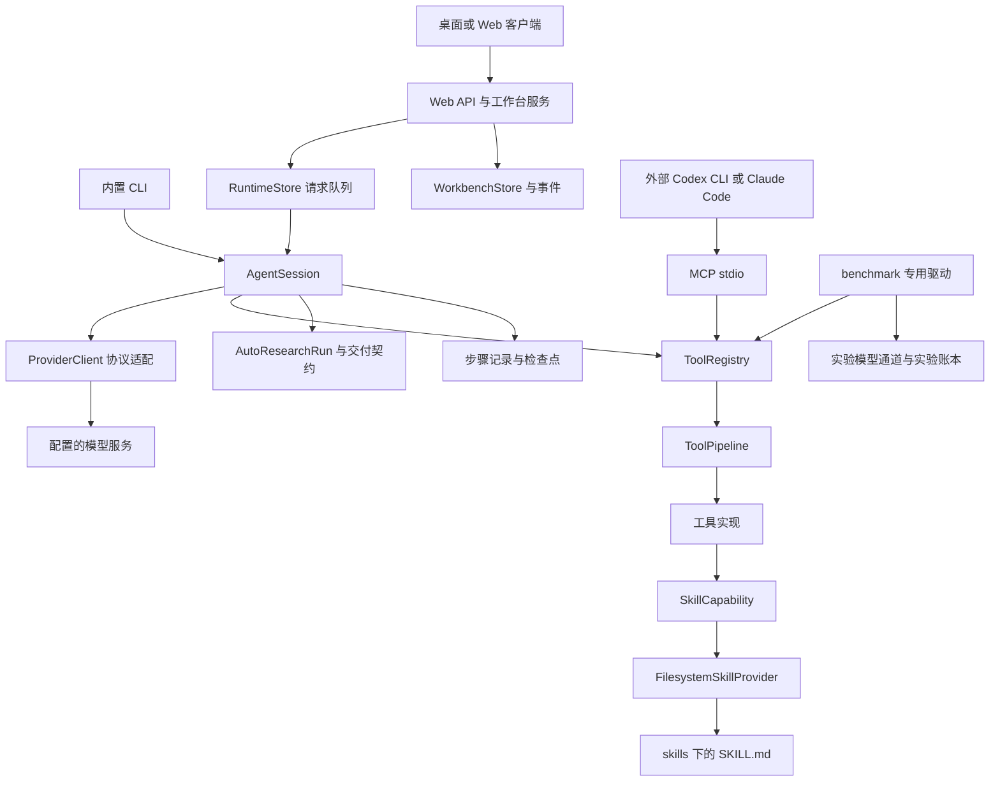
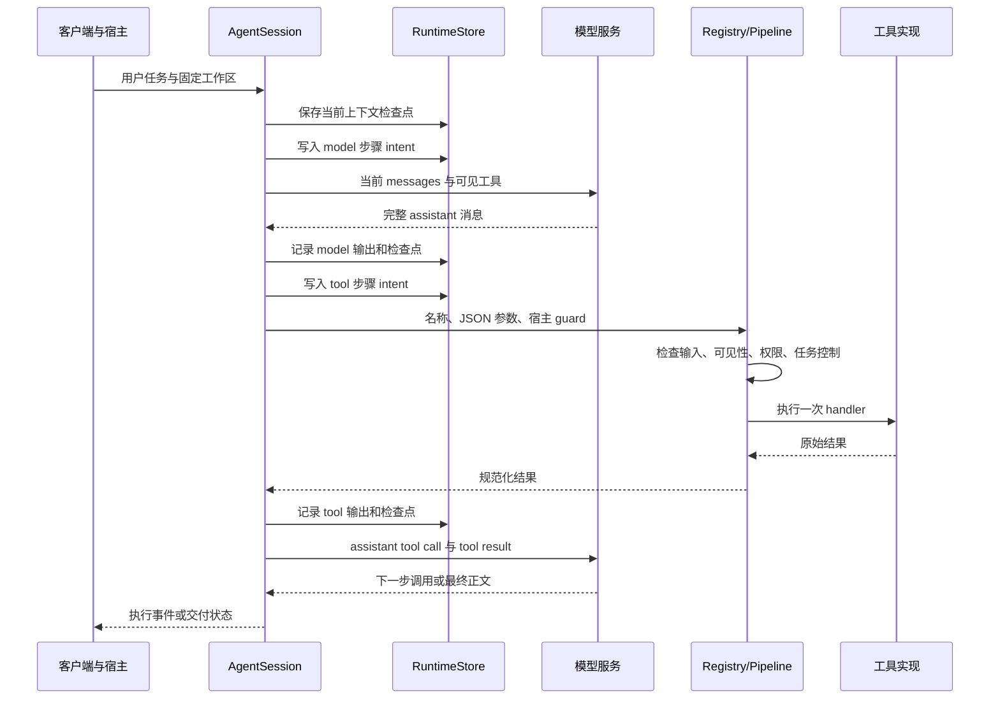
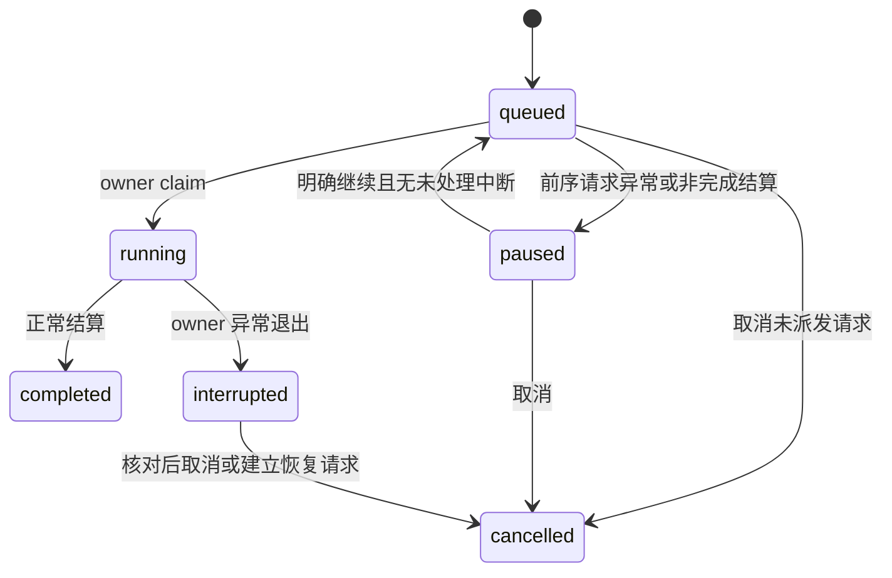

# NeuroRuntime 工程文档

版本：1.1。统一工具接入核对日期：2026-10-20；其他章节的测量数字保留原核对时间。适用对象：维护 NeuroRuntime、接入领域能力、开发桌面或 CLI 客户端，以及复现 harness 对照实验的工程人员。

当前只维护一个 NeuroRuntime 实现。原候选接口 `compile_task`、`read_skill_section` 已合入共享注册表、交互会话、MCP 及 benchmark NR 开启组。后续实验比较 NR 开启与关闭；旧实验 B0/B1 分组、原始失败和评分保留其历史含义。2026-10-20 的源码前后快照及离线测试记录在 `dev/runs/neuroruntime_unified_20261020/`；附录旧源码指纹仍为其标注日期的历史快照。

本文描述当前工作树中的实现。核对时 Git HEAD 为 `f4058415e337f2aeb7a9baafe4229b608261c18f`，工作树含有既存未提交修改，部分 harness 与 benchmark 文件尚未纳入 Git。因此，本文中的实现不能仅凭 HEAD 在干净 checkout 或已安装客户端中复现；交付这些能力时还需要包含相应工作树文件。文末记录关键文件摘要和本次验证结果。

## 阅读导航

| 需要解决的问题 | 对应章节 |
|---|---|
| NeuroRuntime 的组成、边界及调用方向 | 1 至 3 |
| 工具如何注册、授权、执行和返回 | 4 至 6 |
| 技能怎样发现、检索、分页加载 | 7 |
| 交付检查工具具体检查什么 | 8 |
| 多种模型协议怎样共用执行器 | 9 |
| 队列、事件、检查点及中断恢复 | 10 至 12 |
| AutoResearch 怎样推进和验收 | 13 至 14 |
| Goal、状态检查及外部 CLI 接入 | 15 至 16 |
| benchmark 如何绑定输入、记录尝试及比较结果 | 17 |
| 配置、启动、测试、扩展和排错 | 18 至 22 |
| 工程限制、源码定位及版本指纹 | 23 和附录 |

## 1. 定位与核心职责

NeuroRuntime 是 NeuroDiscovery 的研究执行层。模型负责根据任务和上下文提出下一步动作，运行时负责暴露能力、检查调用条件、执行工具、保存执行事实，并按照当前任务模式检查交付。

从工程上可以分成四项职责：

1. **能力组织。** 将工具名称、参数、实现以及技能文档组织为可被模型和外部宿主消费的接口。
2. **受控执行。** 在调用前执行宿主权限与任务控制，在调用后整理实际结果，保留失败和未知状态。
3. **持续执行记录。** 保存请求队列、模型步骤、工具步骤、审批、上下文和交付状态，使重连与恢复有事实依据。
4. **交付检查。** 对 AutoResearch 检查实际文件、执行证据和模式契约，对方案生成实验提供任务清单与静态诊断。

当前实现已有独立的注册表、管线、技能服务和 MCP 出口，但 `AgentSession` 仍是交互式执行的主要协调者，部分研究工具仍由主循环专门派发。维护时应按这些现有边界定位改动，不能假定整个系统已成为可从配置任意组合的插件框架。

### 1.1 名称及其含义

对外系统名称统一为 NeuroDiscovery，执行层及执行代理统一为 NeuroRuntime。NeuroClaw 仅保留于历史记录、许可归属及既有技术标识，不用于当前界面或代理身份。

| 名称 | 工程含义 | 主要入口 |
|---|---|---|
| NeuroDiscovery | 包含桌面、Web、研究功能与评估视图的应用 | `core/cli.py`、`core/web/server.py` |
| NeuroRuntime | 应用内部的模型调用、工具执行、研究状态与交付协调层 | `core/agent/main.py` 及其协作模块 |
| harness | 围绕模型组织能力、执行控制、上下文和证据的运行结构 | 注册表、管线、技能、状态服务、宿主适配 |
| `core/harness.py` | 客户端共享的能力说明与路由声明 | `manifest()`、`/api/harness` |
| `ToolRuntime` | 旧的 `handler.js` / `handler.py` 子进程执行器 | `core/tool-runtime/runtime.py` |
| benchmark driver | 用固定协议运行一个实验条件的执行器 | `neurobench/runner/drivers.py`、`neurobench/runner/cli_drivers.py` 等 |

`core/harness.py` 的 capability manifest 描述客户端有哪些功能；`core/tool_registry.py` 描述模型可以调用哪些函数。前者出现 `graph` 或 `evaluation`，不会自动在后者注册同名工具。

### 1.2 工程完成与科学验收

以下状态需要分别记录：

| 事实 | 能支持的结论 |
|---|---|
| 技能被返回给模型 | 方法说明已加载 |
| 工具返回 `success: true` | 该工具按其接口完成了本次调用 |
| Python 通过 `ast.parse` | 代码在语法层面可以解析 |
| 工具进程退出且输出检查通过 | 本次指定执行及相应工程检查完成 |
| AutoResearch 交付检查通过 | 交付满足当前运行时契约和配置的模型审阅 |
| benchmark 答案获得评分 | 该答案按指定量表完成了评分 |

科学有效性、外部专家验收、数据使用资格、结果泛化性和正式图谱发布，仍依赖对应研究协议及验收证据。

## 2. 整体架构



图中表示逻辑依赖。实际模块之间存在延迟导入，例如 shell 工具的底层执行函数仍位于 `core/agent/main.py`，因此当前依赖关系并非完全单向。

### 2.1 三种消费方式

| 消费方式 | 谁拥有模型循环 | 谁执行 NeuroRuntime 工具 | 状态记录位置 |
|---|---|---|---|
| 内置交互 / AutoResearch | `AgentSession` | 注册表与专用研究工具分支 | 工作台 SQLite、工作区研究记录 |
| 外部 CLI 挂载 | 外部 CLI | MCP 调用注册表 | CLI 原生事件及宿主采集记录 |
| benchmark 专用驱动 | 对应实验 driver | 直接调用注册表，或经 MCP | 实验目录中的独立 SQLite 与 receipts |

外部 CLI 挂载技能时，无需启动 NeuroRuntime 的交互式模型循环。基础 benchmark 的直接 HTTP 路径也不依赖完整 `AgentSession`；它使用较小的 `HarnessHost` 承载工具所需状态。

### 2.2 共享代码与共享协议的范围

共享的是工具定义、技能服务和注册工具的执行管线。不同宿主可以拥有不同的模型调用、预算、审批和记录规则。交互式对话、基础 benchmark、后续 high 开发实验分别有自己的控制路径，不能由“共用 harness”推导出它们的全部请求参数和重试行为相同。

## 3. 模块与职责划分

| 模块 | 关键对象 | 负责的事情 |
|---|---|---|
| [agent/main.py](../core/agent/main.py) | `AgentSession` | 会话、模型循环、控制消息、专用研究工具、完成审阅 |
| [harness.py](../core/harness.py) | `manifest()` | 应用能力声明和 harness 页面入口 |
| [tool_registry.py](../core/tool_registry.py) | `ToolSpec`、`register()`、`dispatch()` | 工具定义、schema 与按名称派发 |
| [tool_pipeline.py](../core/tool_pipeline.py) | `ToolCall`、`ToolPipeline` | 五阶段调用、结果快照、钩子 |
| [tools_impl.py](../core/tools_impl.py) | `register_core_tools()` | 八个核心工具的 schema 和 handler |
| [tool_outcomes.py](../core/tool_outcomes.py) | `normalize_shell_outcome()` | shell 输出中的保守业务失败识别 |
| [permissions.py](../core/permissions.py) | `tool_permission()` | 宿主协作权限策略 |
| [harness_skills.py](../core/harness_skills.py) | `SkillCapability` 等 | 技能目录、检索和分页加载 |
| [skill_loader/loader.py](../core/skill_loader/loader.py) | `SkillLoader` | 本地技能目录和 frontmatter 读取 |
| [harness_validation.py](../core/harness_validation.py) | `task_contract()`、`validate_proposal()` | 公开任务清单与静态方案诊断 |
| [harness_tasks.py](../core/harness_tasks.py) | `compile_task()` | 整理公开任务和指定输入的真实元数据 |
| [llm/adapters.py](../core/llm/adapters.py) | `ProviderClient` | 模型协议转换、流完整性、原生上下文保留 |
| [llm/model_capabilities.py](../core/llm/model_capabilities.py) | `api_mode()`、`request_options()` | 请求协议与模型能力选项 |
| [runtime_store.py](../core/runtime_store.py) | `RuntimeStore` | 队列、步骤、审批、恢复记录 |
| [web/workbench.py](../core/web/workbench.py) | `WorkbenchStore`、`ObservedClient` | 工作台状态、请求事件、原生调用计量 |
| [session/context.py](../core/session/context.py) | `compact_context()` | 上下文归档、压缩与事务边界保护 |
| [instructions.py](../core/instructions.py) | `load_instructions()` | 工作区及目录作用域的指令读取 |
| [autoresearch_runtime.py](../core/autoresearch_runtime.py) | `AutoResearchRun` | 研究进展、证据、预算和交付提交 |
| [autoresearch_contracts.py](../core/autoresearch_contracts.py) | `validate_mode_contract()` | Data / Model / End-to-end 产物约束 |
| [research_review.py](../core/research_review.py) | `build_review_packet()` | 完整文本审阅包及文件绑定 |
| [research_reading.py](../core/research_reading.py) | `read_workspace_page()` | 版本绑定的阅读范围和来源笔记 |
| [goal_runtime.py](../core/goal_runtime.py) | `GoalStore` | 应用内部的有限多轮目标状态 |
| [scheduled_checks.py](../core/scheduled_checks.py) | `ScheduledChecks` | 有次数及时间上限的状态文件检查 |
| [mcp_stdio.py](../core/mcp_stdio.py) | `HarnessHost`、`serve()` | 供外部宿主使用的工具出口 |
| [neurobench/runner/](../neurobench/runner/) | 各 driver、ledger、reporting | 版本化实验及其审计记录 |

设计采用了 Service Definition、Service Provider、Consumer 的分工方式：技能接口、文件系统技能提供者和模型侧技能工具分别承担三个角色。当前代码通过 Python 模块、对象注入和显式注册实现这些边界；替换一个模块仍可能需要调整对应宿主。

## 4. 一次模型与工具往返

### 4.1 交互式执行顺序



此图适用于接入 durable runtime 的路径。纯 CLI 或其他宿主可能未设置 `_runtime_store`，因此不具有上述每一项持久化与审批记录。

### 4.2 主循环执行控制

`AgentSession._chat_openai_with_tools()` 保留类似 Chat Completions 的内部调用形状。底层模型协议可以通过 `ProviderClient` 适配。

一个工具调用进入执行前，主循环会处理：

1. 取消状态和剩余迭代预算。
2. 用户在运行中追加的 steering 指令。
3. 模型输出是否完整。
4. 工具参数能否解析成 JSON 对象。
5. 部分数值参数的基本类型检查，例如正整数 `timeout_sec`、`max_chars`。
6. 工具是否属于本轮可见集合。
7. 宿主权限和必要的用户审批。
8. AutoResearch 的阶段控制、重复读取和准备阶段限制。

注册工具通过 `tool_registry.dispatch()` 进入共享管线。研究专用工具仍由主循环分支调用，它们使用主循环的 preflight 和记录逻辑，但没有全部迁入 `ToolSpec`。

当前主循环按顺序处理一条 assistant 消息中的多个工具调用。工具名称或数量中出现“并行”并不表示这里自动并发执行。

### 4.3 返回正文的语义

普通对话在模型不再请求工具时可以返回正文。AutoResearch 则要求通过 `finish_autoresearch` 提交交付或具体阻断原因；普通正文按进展处理，运行时会在预算内继续，或明确以停滞、取消、预算耗尽等状态结束。

`benchmark_mode`、`no_skill_mode` 仍服务于当前 AgentSession 回答协议。旧批量执行入口已移除；任务与报告解析、评分和榜单统一在 `neurobench/runner/scoring.py`，500 任务 Codex 执行器位于 `neurobench/runner/codex500.py`，均使用普通模块导入。

## 5. 工具注册与接口

### 5.1 `ToolSpec` 与注册表

每个 `ToolSpec` 包含四项：

```python
@dataclass(frozen=True)
class ToolSpec:
    name: str
    description: str
    parameters: Mapping[str, Any]
    handler: ToolHandler
```

handler 的统一形状为：

```python
def handler(session, arguments, workspace) -> dict:
    ...
```

`session` 在这里表示宿主对象，可以是完整 `AgentSession`，也可以是满足所需属性的 `HarnessHost`。工具不能默认所有宿主都拥有模型客户端、检查点管理器或完整研究状态。

| 接口 | 行为 |
|---|---|
| `register(spec)` | 保存按名称索引的工具；拒绝冲突定义 |
| `get(name)` | 获取一个工具定义，未知名称返回 `None` |
| `names()` | 返回当前进程中已注册名称 |
| `schemas(include=..., exclude=...)` | 按注册顺序生成 provider-facing schema |
| `dispatch(..., guard=...)` | 经过宿主管线派发一次调用 |
| `canonical_schema_digest()` | 对序列化工具 schema 计算 SHA-256 |

当前幂等注册规则允许相同对象，或 description 与 parameters 相同的定义重复注册，并保留旧定义。因此替换 handler 不能靠相同 schema 的再次注册完成。schema digest 也只标识可见定义，执行行为的版本还需要源代码绑定。

### 5.2 已注册工具

调用 `register_core_tools()` 后得到八个核心工具：

| 工具 | 主要参数 | 默认值或限制 | 实际作用 |
|---|---|---|---|
| `run_shell_command` | `command`、`timeout_sec` | 默认 180 秒 | 在工作区通过平台 shell 执行命令 |
| `inspect_local_path` | `path` | 权限和范围由宿主检查 | 查询文件或目录的存在性、类型、大小 |
| `read_workspace_file` | `path`、`max_chars`、`offset`、`paper_start`、`paper_count` | 默认 12,000 字符；读取器上限 40,000；默认 5 篇、最多 50 篇 | 文本或文献记录分页读取 |
| `spawn_subagent` | `task`、`persona`、`skills_filter`、`mode` | `run_and_return` 或 `fire_and_forget` | 请求应用内部子代理服务 |
| `search_skills` | `query`、`limit` | 默认 8；schema 声明 1 至 25 | 检索技能名称与摘要 |
| `read_skill` | `name`、`offset` | 每页默认 20,000 个规范化字符 | 加载指定技能正文 |
| `compile_task` | `task_text`、`input_paths`、`public_contract` | 最多 64 个指定输入；宿主绑定任务优先 | 汇总公开要求、真实文件元数据和最多 4 个技能候选 |
| `read_skill_section` | `name`、`query`、`max_chars` | 默认 4,800 字符，上限 20,000 | 按相关度选择技能段落，保留来源哈希和会话缓存 |

`register_validation_tools()` 可再注册 `describe_task_contract`、`validate_proposal`。

注册表并未提供完整的 JSON Schema 运行时验证器。schema 中的限制、主循环检查、handler 检查和 provider 检查承担不同职责。新增一个 schema 约束时，必须确认需要的执行端约束也已实现。

### 5.3 注册、可见与授权

这三个集合分别由不同代码决定：

```text
已注册：当前进程能按名称找到哪些 ToolSpec
可见：当前宿主向模型发送哪些 schema
授权：当前调用是否允许进入 handler
```

本次默认配置下，可见核心集合为四个旧工具，技能工具由 `NEUROCLAW_HARNESS_SKILL_TOOLS` 控制。方案检查工具还需要完成注册，并由 `NEUROCLAW_HARNESS_PROPOSAL_CHECKS` 控制交互路径可见性。专用 benchmark 宿主可以自行选择注册表子集。

例如，`spawn_subagent` 可以出现在默认 schema 中，但 durable runtime 的 `tool_permission()` 当前始终拒绝它。修改展示集合不能替代权限实现。

### 5.4 结果结构

当前工具结果为 JSON 对象，使用约定字段，尚未统一成一个覆盖所有工具的强类型返回类。

| 字段 | 含义 |
|---|---|
| `success` | 本次工具操作是否按自身契约成功 |
| `executed` | 是否实际进入执行，或是否完成了该工具定义的操作 |
| `error_type` | 可供宿主识别的失败类别 |
| `error` | 失败说明 |
| `outcome_unknown` | 已进入执行，但结果不足以证明副作用终态 |
| `failure_stage` | 管线错误发生阶段 |
| `stdout`、`stderr`、`exit_code` 等 | 由具体工具提供的执行事实 |

并非每个结果都含有全部字段。读取说明、静态检查和外部工作流执行的 `executed` 含义也不同，消费方应结合工具身份解释。

## 6. 五阶段执行管线

`ToolPipeline` 是同步对象。宿主可以设置自己的 `_tool_pipeline`；没有设置时使用 `DEFAULT_PIPELINE`。

```text
输入快照
    ↓
pre_execute
    ↓
guards
    ↓
execute wrappers → handler，至多一次
    ↓
post_execute
    ↓
最终规范化、保留拒绝结果
    ↓
result observers
    ↓
返回独立 JSON 快照
```

### 6.1 每个阶段的契约

| 阶段 | 回调形状 | 可以做的事情 | 约束 |
|---|---|---|---|
| `pre_execute` | `(call) -> dict 或 None` | 输入检查、提前拒绝 | 返回的拒绝必须含 `success: false` |
| `guards` | `(call) -> dict 或 None` | 权限、取消、任务阶段检查 | 组合宿主内置和本次调用 guard |
| `execute` | `(call, next) -> dict` | 计时、包装或短路执行 | handler 不能被 wrapper 重复调用 |
| `post_execute` | `(call, result) -> dict 或 None` | 转换结果、补充结构化信息 | 拒绝不能被改成成功 |
| `result` | `(call, frozen_result) -> None` | 观察最终结果 | 收到递归只读快照；异常仅记录日志 |

### 6.2 参数与结果的不可变边界

进入管线时，参数先经过无损 JSON 快照检查。允许字符串键对象、列表、有限数字、布尔值和 `null`；不允许 NaN、无穷值或任意 Python 对象。

`ToolCall` 内的嵌套对象以只读映射和 tuple 提供给钩子，handler 获得分离的 JSON 副本。这样，审批检查过的原始调用不会被后续钩子悄悄改写。

这属于进程内接口约束。持有 Python 对象和文件系统权限的任意扩展代码仍需信任，不能将它解释为进程隔离。

### 6.3 异常、拒绝与未知结果

handler 抛出异常时，管线返回 `tool_execution_error`，并标注已执行及 `outcome_unknown: true`。其他阶段错误返回 `tool_pipeline_error` 和对应阶段；如果工具已被调用，同样保留未知结果标记。

一旦 guard 拒绝，结果中的拒绝事实在 post-processing 后仍保留，并明确 `executed: false`。观察者异常不会改变已经向其他消费方发布的结果。

`run_shell_command` 最后还经过 `normalize_shell_outcome()`：某些输出明确报告缺依赖或业务失败，即使命令包装隐藏了失败退出码，也会被保守识别。它包含读取日志类命令的例外，仍属于启发式检查，不能替代工具自身的输出与产物验收。

### 6.4 “至多执行一次”的适用范围

管线阻止同一次 `run()` 内 wrapper 重复调用工具 body。这不等于整个系统提供分布式 exactly-once。进程可能在外部动作完成后、记录结果前退出；此时 durable journal 保留 intent，恢复流程要求核对实际副作用。

## 7. 技能服务的实现细节

### 7.1 三个角色

| 角色 | 实现 | 接口 |
|---|---|---|
| Definition | `SkillCapability` | `catalog()`、`search()`、`load()`、`load_section()` |
| Provider | `FilesystemSkillProvider` | 将本地目录转换为 `SkillRecord` |
| Consumer | `search_skills`、`read_skill`、`read_skill_section` | 模型可见工具；通过注册表执行 |

`SkillRecord` 保存 name、description、summary、path、skill_md、layer、skill_type。Provider 使用现有 `SkillLoader`，无需为了接入模型工具再维护第二套技能目录解析器。

### 7.2 目录发现与优先级

标准目录形状：

```text
skills/
  example-skill/
    SKILL.md
    references/       可选
    scripts/          可选
    handler.py        可选，旧执行器识别
```

`SkillLoader` 默认先检查当前工作目录的 `./skills`，再检查显式传入目录。重复的文件路径只加载一次。`SkillCapability` 合并多个 provider 时，同名技能按小写名称匹配，优先保留先遇到的记录。

交互场景保留当前目录优先的历史约定。实验必须使用 `include_cwd=False` 和冻结技能目录，防止启动目录中的另一份技能覆盖绑定材料。

技能 frontmatter 可以提供 `name`、`description`、`layer`、`skill_type` 等元数据；缺少 name 时使用目录名。handler 的存在与技能正文能否被读取是两件独立的事。

### 7.3 当前检索算法

当前 `search()` 使用确定性的关键词包含匹配：

1. 查询转小写，按空白、逗号、分号和斜线分词。
2. 一个词命中技能名称加 3 分；否则命中 description、summary、type、layer 等拼接文本加 1 分。
3. 只保留分数大于零的记录。
4. 按得分降序、名称长度升序、名称字典序排列。

这是词面检索，没有 embedding、外部搜索或 LLM 重排。用户提供的中文表达与英文技能目录不一定直接匹配，模型需要使用合适的任务词。

本次在显式项目技能目录、关闭 cwd 继承的条件下读取到 **102 个技能**；`ADNI BIDS` 的首个结果为 `adni-skill`。这两个数字是核对快照，目录更新后应重新测量。

### 7.4 加载、分页和摘要

`load()` 按目录中的完整技能名匹配，名称比较不区分大小写，不接受任意路径。读取原始 UTF-8 字节后，统一 CRLF / CR 为 LF，再按字符 offset 分页。

| 返回字段 | 用途 |
|---|---|
| `content` | 本页方法说明 |
| `offset`、`total_chars` | 在规范化正文中的字符位置 |
| `truncated`、`next_offset` | 判断是否还需要下一页 |
| `source_sha256` | 原始文件字节摘要 |
| `content_sha256` | 规范化全文的 UTF-8 摘要 |
| `content_kind` | 当前为 `method_guidance` |
| `workflow_executed` | 当前明确为 `false` |
| `usage_guidance` | 方法适配和真实执行证据的使用说明 |

两个摘要的区别使 Windows 换行与规范化内容可以分别核对。摘要针对完整源文件或规范化全文，而非只针对当前页。

目录记录被缓存在 `SkillCapability` 实例中；`load()` 会重新读取对应文件正文。修改技能成员或元数据后应重新创建 capability，冻结实验则必须先处理版本变更，不能热替换正在使用的材料。

### 7.5 技能被模型消费后的作用

模型根据任务选择相关说明、读取必要页面，并将方法用于当前输入、输出和约束。`read_skill` 不会自动运行该技能的 scripts，也不执行旧 `handler.py` / `handler.js`。

内置交互路径可以在 system prompt 中提供简短技能目录，再由模型按需加载正文。基础 benchmark 不预先注入技能正文，而是通过工具完成发现和读取。后续机制比较为各组提供相同公共方法材料，具体差异由实验协议定义。

### 7.6 技能片段与会话缓存

`read_skill_section` 在技能前 200,000 个规范化字符中按查询词命中数选择段落，结果按原文顺序组织，并遵守返回字符上限。`source_scan_truncated` 和 `source_next_offset` 披露未扫描部分，完整分页仍使用 `read_skill`。返回原始来源、规范化全文及所选片段的哈希。

缓存由会话的 `SkillCapability` 持有，最多保留 32 个结果。重复读取前核对来源哈希，技能修改后不会命中旧内容；不同会话不共享缓存。MCP 在一条 stdio 会话中复用同一个 `HarnessHost`，直连 benchmark 在一次尝试内复用宿主。读取只提供方法说明。

### 7.7 公开任务与输入元数据

`compile_task` 汇总调用方已有的公开任务和契约，检查明确列出的工作区输入，并检索最多四个相关技能。宿主绑定的任务正文优先于调用方传入的替代正文。它不推断解题步骤、隐藏答案或验收数值。

元数据包含文件存在性、大小、可计算时的 SHA-256，以及 `.npy` 的形状与类型、NIfTI 的形状、类型和 affine。NumPy、nibabel 按需导入；不安装依赖或加载影像体素数组。仅对不超过 64 MiB 的文件计算完整哈希，较大文件明确标记 `omitted_size_limit`。缺失文件按缺失返回，路径必须位于工作区内。

## 8. 任务契约和静态交付检查

`core/harness_validation.py` 提供两个可选工具，版本标识为 `neuroruntime-proposal-checks-20261013-r1`。

### 8.1 `describe_task_contract`

输入来自宿主绑定的 task text 或显式 `task_text`。优先级为：宿主内存中的固定文本、绑定文件及其预期 SHA-256、最后才是调用参数。

`task_contract()` 对任务文本生成公开的输入、输出和完成条件清单，并附上任务摘要。当前包含环境、FreeSurfer、tracking、BIDS、学习任务和统计设计等规则。规则由词面触发，不是隐藏标准答案。

### 8.2 `validate_proposal`

输入为完整提案 `proposal`，最大 500,000 个字符。当前检查包含：

| 检查项 | 实现方式 | 结果级别 |
|---|---|---|
| 两个顶层回答段落 | 检查 `Solution Thinking`、`Commands Or Code` 顺序 | 明确结构错误 |
| Markdown 代码围栏 | 识别反引号或波浪线围栏及闭合长度 | 未闭合为错误 |
| Python 代码 | `ast.parse()` | 解析通过或语法错误 |
| 无完整代码块 | 记录未覆盖范围 | review 提示 |
| FreeSurfer | 启动、退出处理、新产物证据的保守检查 | 错误或 review 提示 |
| tracking | theta / phi / f 采样集、空间和变换说明 | review 提示 |
| 环境验证 | 已发现可执行文件是否还检查 prefix 归属 | review 提示 |
| 学习流程 | 检查可见代码中 fit 与 split 的顺序 | review 提示 |

代码围栏解析器允许更长外层围栏，避免把其中的短反引号误当作结束。非 Python 代码块会标注 `not_parsed`，不会被写成语法已通过。

返回 `success: true` 表示诊断工具完成，不代表方案没有错误。消费方应读取 `status`、`blocking_error_count`、`findings` 和 `syntax_blocks`。

检查明确返回 `workflow_executed: false`、`scientific_correctness_verified: false`。review 提示是需要审阅的线索；正则没有发现某个动作，不能直接证明提案缺失该动作。一次静态反馈修复的允许次数由宿主实验预算决定。

## 9. 多模型协议适配

### 9.1 统一内部形状

`ProviderClient` 将原生服务暴露成内部兼容接口：

```python
client.chat.completions.create(model=..., messages=..., **options)
```

执行器因此可以保留 `choices[0].message`、tool calls 与统一 usage 的处理方式。适配层根据配置选择 Chat Completions、Responses 或 Anthropic Messages。

| 目标协议 | 主要转换 |
|---|---|
| Chat Completions | 保留 messages / function tools，整理流式工具参数、reasoning 与用量 |
| Responses | messages 转 input items；tool result 转 `function_call_output`；effort 转 `reasoning`；统一输出 token 参数 |
| Anthropic Messages | system 与消息分离；工具转 `input_schema`；结果转 user 消息中的 `tool_result`；合并连续同角色块 |

这些是当前适配器的代码行为，外部服务是否实际支持某个模型和参数仍需对应通道的真实验收。

### 9.2 原生推理上下文与模型绑定

适配器通过 `_nd_protocol` 保存 Responses output items 或 Anthropic content blocks 及其模型 / provider 绑定。签名、推理块和不透明字段按原始记录往返，不根据正文补造。

同一工具事务中切换绑定会报错，要求开始新回合。旧历史只有可见文字而缺少必要原生推理字段时，以明确标记的历史参考文本导入，不虚构缺失的 reasoning。

Responses 的无状态往返会请求保留适配器需要的加密 reasoning 内容，并设置相应存储选项。该不透明内容属于协议上下文，不应当作最终回答展示。

### 9.3 流完整性

| 协议 | 当前完成条件 |
|---|---|
| Chat Completions stream | 观察到允许的终止原因，例如 `stop` 或 `tool_calls` |
| Responses stream | 收到 `response.completed`，并核对输出 item 状态 |
| Anthropic stream | 收到 `message_stop`，再组装完整 content blocks |

长度截断、缺少 completion、过滤、错误或未完成 item 会形成 `IncompleteModelResponse`。执行器不能把尚未完整接收的函数参数拿去执行。

适配器本身不做 provider fallback，也不在 import 时请求模型。外围调用策略仍需分别检查：durable / AutoResearch 工具循环收紧重试，传统普通对话分支保留历史重试，benchmark 的 SDK 自动重试则被单独关闭。

### 9.4 模型观测与用量

Web 通过 `ObservedClient` 在真实 create 调用前记录 call，并发出 `model_start`、文本、reasoning 和 terminal 事件。流中已经见到原生事件后再发生传输失败，会保留不完整结果，防止将未知生成视为可无痕重试的普通错误。

记录使用实际 model、provider 和调用来源，辅助模型调用可标记为 `auxiliary`。缺失用量保持未报告状态。Anthropic 的输入统计还需要计入原生独立报告的 cache read / creation，避免只取 uncached input。

## 10. 权限与执行边界

### 10.1 协作权限策略

`core/permissions.py` 明确提供 cooperative tool policy。当前模式为 `ask`、`risk`、`never`、`read_only`。

| 工具类别 | `ask` | `risk` | `never` | `read_only` |
|---|---|---|---|---|
| 技能检索与读取、方案静态检查 | 允许 | 允许 | 允许 | 允许 |
| 工作区内文件读取 / 路径检查 | 通过范围检查后允许 | 同左 | 同左 | 同左 |
| shell | 请求审批 | 仅 `pwd`、`cd`、`ver` 直接允许，其余请求审批 | 允许 | 拒绝 |
| `search_pubmed`、`write_research_file` | 请求审批 | 请求审批 | 允许 | 拒绝 |
| `spawn_subagent` | 拒绝 | 拒绝 | 拒绝 | 拒绝 |
| 未识别工具 | 拒绝 | 拒绝 | 拒绝 | 拒绝 |

`never` 表示不询问本策略覆盖的获准动作，不表示跳过其他 guard。部分研究动作有独立规则，例如图谱假说生成 / 排序按只读服务处理，来源笔记检查其工作区范围，`finish_autoresearch` 进入交付校验。这些专门规则应直接核对 `tool_permission()`。

审批通过 durable store 绑定到 request 和 step。`AgentSession` 发出 pending 事件并等待决定，当前等待上限为 300 秒，取消和超时都使本次执行不获批准。

### 10.2 宿主差异

| 宿主 | 策略特点 |
|---|---|
| durable Web 请求 | `_tool_authorized()` 使用权限模式与持久化审批 |
| standalone MCP / `HarnessHost` | 设置宿主 guard，使用 `read_only` 判断 |
| 未接入 RuntimeStore 的旧调用 | `_tool_authorized()` 存在直接放行分支，不能假设有 Web 审批 |
| 外部 CLI | NeuroRuntime 管理其 MCP 工具；CLI 自带工具受 CLI 与实验配置控制 |

`NEURORUNTIME_MCP_TOOLS` 扩展名字列表，不会授予 shell 或子代理执行权限。调用即使被列出，仍要通过 `HarnessHost` 的只读 guard。

### 10.3 shell 和检查点

当前 shell 在工作区运行，继承进程环境。Windows 工具说明要求使用 `cmd.exe` 语法，不能把开发终端使用 PowerShell 等同于模型 shell 工具也使用 PowerShell。

对符合条件的非只读 shell 操作，工具可以先请求 `ShadowCheckpointManager` 创建工作区检查点。这个检查点帮助检查或恢复文件变更，和 RuntimeStore 的模型 / 工具事务检查点不同。它不回滚网络请求、外部数据库或其他远端副作用。

本地路径检查、审批和 shell 规则没有提供 OS 级隔离。操作系统 sandbox 与广泛架构泛化按当前项目方向延后。

## 11. 持久化队列、事件及数据位置

### 11.1 应用状态数据库

默认工作台数据库为：

```text
~/.neurodiscovery/workbench.sqlite3
```

`NEURODISCOVERY_WORKBENCH_DB` 可以覆盖该位置。Web 中的 WorkbenchStore、RuntimeStore 和 GoalStore 使用同一个选定路径，并各自管理对应表。

| 表或表组 | 主要内容 |
|---|---|
| `state`、`recovery` | 工作台 revision 和冲突恢复内容 |
| `calls` | 模型原生调用身份、状态和用量 |
| 工作台 `runs` | 请求事件与可重连状态 |
| `runtime_queue` | durable 请求、工作区绑定、顺序与 owner |
| `runtime_steps` | 模型 / 工具 / 摘要步骤的输入意图和已记录输出 |
| `runtime_checkpoints` | 可恢复的消息和研究状态 |
| `runtime_approvals` | 单步审批状态与参数 |
| `runtime_owners` | 运行 owner 与进程身份 |
| `runtime_context` | 已压缩对话及对应队列范围 |
| `runtime_goals` | 应用内部 Goal 状态 |
| `scheduled_checks` | 状态检查任务及其预算 |

benchmark 也存在名为 `runs` 的表，但位于独立实验数据库，其字段和语义不同。排查前应先确认打开的是哪一个数据库。

### 11.2 队列不变量

`RuntimeStore` 使用 SQLite WAL 和事务维护以下约束：

1. request ID 与规范化 payload 绑定。相同 ID、相同内容重复 enqueue 返回原记录；相同 ID 换内容会拒绝。
2. 单个 payload 最大 8 MiB。
3. 同一对话的工作区不能在后续排队请求中切换。
4. 条件唯一索引保证同一 chat 只有一个 `running` 请求。
5. `claim()` 在事务中选择待执行行；当前存在 running、paused 或 interrupted 时不继续抢占。
6. `finish()` 验证 owner，避免失去所有权的执行器覆盖结果。



执行器还可结算其他状态；`finish()` 的 status 由调用方提供，不是一个只接受图中状态的封闭 enum。对于非 completed 结算，后续排队工作会暂停。

### 11.3 客户端重连

`WorkbenchRun` 给事件编号，客户端按游标轮询已保存事件。重连主要恢复展示，不应为了恢复页面再发送同一个模型任务。工作台 state 使用 revision 防止多个客户端覆盖彼此修改，冲突通过单独恢复记录保存。

## 12. 中断、恢复、指令与上下文

### 12.1 写前意图和未知窗口

每个受记录步骤先 `begin_step()` 写入 `intent`，执行后再 `end_step()` 原子保存输出与新检查点。

| 中断位置 | 本地可知事实 | 恢复行为 |
|---|---|---|
| 尚未 claim | 未开始该请求 | 可以按队列正常派发 |
| 已写 intent，尚无 recorded | 动作可能开始或已经完成 | 保留 uncertain step，要求核对 |
| 工具输出与检查点均 recorded | 有已保存的工具结果 | 从安全边界判断是否可继续 |
| assistant 消息已保存但流程未结算 | 模型已返回内容 | 先检查已有回答，拒绝直接再生成 |
| 已提交交付或审阅状态 | 完成声明或审阅事实已经存在 | 先检查 receipt，不能重复提交流程 |

owner 异常退出后，请求标为 interrupted，后续 queued 行变 paused，相关未决审批变 denied。重启不将旧 running 行直接重新投入执行。

`resumable()` 同时检查是否存在 intent、缺失检查点、未闭合 tool-call transaction、已经保存的 assistant 回答，以及已记录的交付 / 审阅状态。符合条件后，`enqueue_recovery()` 用新 request ID 建立恢复请求，保留来源关系，并核对检查点未变化。

### 12.2 工作区指令

`load_instructions()` 从选定工作区读取 `SOUL.md`、`AGENTS.md`、`USER.md`、`MEMORY.md`，并记录实际字节 SHA-256。根 SOUL 缺失时可使用显式 fallback。

主要读取规则包括 UTF-8 BOM 支持、换行规范化、单文件 256,000 字节上限和拒绝指令符号链接。读取子目录文件时，`scoped_instructions()` 可以附上沿目录路径适用的嵌套 AGENTS。

文件中的历史任务和记忆内容是参考，不能自动变成新的执行授权。运行中追加指令由 `_consume_instructions()` 在边界加入消息，并记录 steering 事件；进入完成审阅后，新的任务需要按宿主规则排队。

### 12.3 上下文压缩

`compact_context()` 估算：

```text
estimated_tokens = len(JSON(messages) 的 UTF-8 字节) // 3 + 1
```

这是压力估计，不是模型 tokenizer 的精确 token 数。默认预算为 24,000，参数最小为 2,048。

处理顺序为：

1. 显式具备 `native_compact` 能力时，先尝试宿主原生压缩。
2. 按 user 消息边界或完整工具事务边界选择可归档前缀。
3. 将完整旧消息保存到工作区 `.neurodiscovery/context/<sha256>.json`。
4. 默认生成抽取式摘录；配置允许时再做有限的语义摘要。
5. 保留 system / developer 指令、必要的当前 user 请求和近期完整事务。
6. 替换后若没有减少压力，返回 pressure，避免宣称压缩成功。

语义摘要是显式 opt-in。摘要调用计入运行预算，并且失败后可退回完整归档加抽取式记忆。摘要及历史摘录都带有“不完整参考”的标记，后续依赖被省略决定或证据时应回读原始归档。

### 12.4 文献分页与来源笔记

`read_workspace_page()` 对工作区内最多 8 MiB 的 UTF-8 来源文件计算字节摘要。阅读账本最多保留 32 个来源文件，分别维护字符范围和完整论文记录范围；文件摘要变化时建立新版本的覆盖记录，不能沿用旧文件的“已读”状态。

存在阅读账本或显式 paper_start，且文件满足文献 JSON 结构时，读取器可以按完整论文记录返回。每页同时受 paper_count 与 max_chars 限制，不能容纳一篇完整记录时返回明确错误，不截掉后半篇再将整篇标为已返回。显式 offset 强制文本模式，offset 与 paper_start 不能同时提供。

在 AutoResearch 中省略游标会从第一个未返回范围继续；显式游标表示有意回读。空页通过 EOF、already_returned 等字段解释，避免模型把已结束读取当作失败而重新循环。

`record_research_note` 要求引用实际返回过的 source ID 和 paper index，并检查引文在源字段中存在。当前每条笔记摘要最多 4,000 字符，最多 10 条引文，每条引文最多 500 字符；Unicode 空白可规范化后匹配。它绑定来源与返回范围，不证明笔记中的推论成立。

### 12.5 区分几种检查点

| 机制 | 保存内容 | 不能替代的能力 |
|---|---|---|
| RuntimeStore checkpoint | messages、工作区身份、permission mode、研究状态 | 不提供外部副作用回滚 |
| 内容寻址 context archive | 压缩前完整历史消息 | 不等于任务执行进展 |
| SessionManager 兼容检查点 | 会话 history 与 metadata JSON | 不提供 intent / result 事务结算 |
| ShadowCheckpointManager | 工作区文件检查与恢复所需状态 | 不证明研究结果，也不撤销远端动作 |

排错时先确认所用检查点类型，再决定读取、比较还是恢复。仅发现一份 history JSON 不足以证明某条 shell 已经完成，也不能代替 durable journal 的安全边界检查。

## 13. AutoResearch 执行状态与交付验收

### 13.1 模式和状态文件

当前公开模式为 `off`、`data`、`model`、`idea`、`end-to-end`。选择模式只改变任务解释和可用能力，不因为用户切换选项就自动启动研究。

每个 `AutoResearchRun` 保存到：

```text
<workspace>/.neurodiscovery/autoresearch/<run-id>/run.json
```

状态包括 objective、mode、iterations、iteration_limit、evidence、artifacts、research_progress、阅读范围、修复历史和审阅记录等。保存使用临时文件再替换，避免正常写入中断留下半个 JSON。

### 13.2 进度与预算

`iteration_limit()` 默认 40；`NEUROCLAW_MAX_TOOL_ITERATIONS` 可以指定正整数。它约束模型调用，包括相关审阅与语义压缩，不只计算 shell 动作。非法显式值不会被解释为无限预算。

运行时观察实际工具结果和材料变化，区分准备、读取、综合及交付。重复读取已经覆盖而无新内容的范围会被提示或限制；明确提供 offset / paper_start 的有意回读另行处理。当前普通重复读取阈值常量为 2。

阅读账本记录“返回给模型的范围”，不能证明模型完成理解或科学评审。来源笔记绑定返回过的文献索引、source ID 和引文，并作为未验证分析记忆保存。

### 13.3 研究工具的分工

| 工具 | 作用 |
|---|---|
| `inspect_research_progress` | 检查指定材料是否产生新的可用进展 |
| `search_pubmed` | 在授权范围内获取文献，保留获取结果 |
| `write_research_file` | 按路径和任务限制保存研究材料 |
| `record_research_note` | 保存来源绑定的分析笔记 |
| `generate_idea_hypotheses` | 调用现有证据 / 假说链能力 |
| `rank_idea_hypotheses` | 对候选和对应证据进行排序 |
| `finish_autoresearch` | 提交 checked 交付，或报告具体 blocker |

这些工具保留在研究状态分支中。迁移它们时应同时保留 provenance、状态推进、权限和完成行为，不能只迁移 schema。

### 13.4 `finish_autoresearch` 的提交要求

工具要求 status、summary、artifacts、validation、evidence_ids。completed 交付需要：

1. 单独调用该工具，前序执行与校验结果已返回，待处理 steering 已应用。
2. 交付文件位于工作区内，存在且非空，不能拿运行时 receipt 代替研究交付。
3. evidence_ids 来自当前运行真实记录，且存在成功、已执行的相关证据。
4. Data / Model / End-to-end 满足对应模式 manifest。
5. Idea 等相关路径满足配置要求的链检查与 novelty gate。
6. 配置要求独立模型审阅时，先进入 verifying，再依据审阅结果决定是否 completed。

blocked 提交还要给出 `blocker_kind`、具体缺失条件和实际尝试过的恢复。授权或预算类 blocker 有相应例外；一般缺输入 / 执行 blocker 不能只凭猜测报告。

### 13.5 完整审阅包

`build_review_packet()` 使用提交时文件的完整 UTF-8 内容：

| 限制 | 当前值 |
|---|---:|
| 交付文件数 | 1 至 12 |
| 文件内容合计 | 512 KiB |
| 加入证据等元数据后的包大小 | 1 MiB |

文件超限、缺失、不是有效 UTF-8 或打包期间摘要变化都会阻止该次审阅，不静默截断后再声称完整审阅。二进制结果需要完整文本报告及足够的源绑定。

审阅在独立、只读、无工具的模型调用中进行，可以使用配置的 `_review_llm`；未设置时可能仍是同一模型服务。这里的独立指调用上下文和职责分离，不是不同模型、人类专家或统计独立性。

拒绝后默认不会无限自修。配置的 `autoresearch_repair_limit` 还受最多 3 次、剩余迭代预算、取消状态和完整反馈记录约束。审阅反馈不能扩展原任务授权。无法验收时保留 `review_required` 等明确未完成状态。

## 14. Data、Model 和 End-to-end 交付契约

契约检查器以实际文件和哈希为输入，不能只凭 manifest 中的文字声明判定通过。

| 模式 | 当前契约 | 必需内容的主要范围 |
|---|---|---|
| Data | `neuroclaw.data.v2` | 输入输出文件、ID、shape / schema、split、变换来源及 QC |
| Model | `neuroclaw.model.v2` | 模型输入、split、training seed、baseline、config、metrics、checkpoint |
| End-to-end | `neuroclaw.end_to_end.v2` | Data / Model manifest、Idea chain、ranking、novelty 与 validation |

### 14.1 文件与身份绑定

文件记录使用 path 和 SHA-256。subject IDs 通过独立 JSON 列表绑定，检查唯一身份、subject_count 和 IDs 摘要；CSV / TSV 还要指明并核对 subject ID 列。

这些要求使“manifest 写了 120 人”和“实际数据有 120 个对应被试”可以分别检查。文件存在本身不能证明内容或身份关系正确。

### 14.2 split 与变换

train、validation、test 三份 subject 列表应互不重叠，并按契约覆盖输出身份。使用 family、site 等 group_key 时，还需要实际 subject-to-group 映射，避免同组跨集合。

变换记录其名称、参数、实现来源和 `fit_on`。声明在 train 拟合时，拟合 IDs 摘要必须匹配训练集合。Model 的输入和 split 要与 Data 交付一致，不能后续悄悄重分组。

### 14.3 QC、模型和端到端结果

Data QC 需要具名检查、观察值、准则和绑定报告。Model 需要 baseline、非空配置、指标来源及 checkpoint，而不仅是一个模型名称。

End-to-end 额外绑定非空 Idea chain / ranking、novelty 的 reviewed / held / rejected 记录，以及 validation 的 passed / failed / inconclusive 记录。记录一个结论状态不等于该结论一定为正，工程契约也不授权改变研究标准。

新增模式或字段时，应同步检查 `CONTRACT_VERSIONS`、校验分支、`mode_contract_prompt()`、实际完成入口和客户端帮助。当前版本号属于模式交付契约，与 `core/harness.py` 的整体 `runtime_contract: autoresearch-v1` 不是同一层级。

## 15. 应用内部 Goal 和状态检查

本章描述 NeuroDiscovery 自身代码中的可选外层服务。当前会话所在 Camellia 的 Goal 与 Tasks 由其自身工具管理，不能把下面的 Python 类或 HTTP API 当成宿主控制接口。

### 15.1 GoalStore

Goal 通过有限多轮队列请求推进，复用已有执行器。主要状态为 active、paused、blocked、verifying、complete、cancelled。每个对话限制一个 unfinished goal。

默认 `max_turns=12`，允许 1 至 40；每轮绑定 request ID，不能同时绑定另一活跃请求。入队失败可以退还尚未真正进入队列的 turn 预算。

执行器的完成 marker 只是送审信号。Goal 完成检查结合结果、工作区文件事实和单独审阅，核对通过后才进入 complete。后端重启将 active / verifying 改为 paused，取消尚未派发的旧 Goal turn，需要用户明确恢复。

### 15.2 ScheduledChecks

这是有限的状态文件观察服务：检查间隔 1 至 1,440 分钟，次数 1 至 144，总持续时间 1 至 24 小时。路径必须是工作区内的相对状态文件。

检查读取状态和文件绑定，不调用研究执行器，不自动修复或重启实验，`max_repairs` 固定为 0。重启后暂停。检查次数耗尽时任务 completed 仅表示观察预算结束。

## 16. MCP 与外部 CLI 接入

### 16.1 服务形状

`core/mcp_stdio.py` 提供按物理 LF 分隔的 JSON-RPC 2.0 stdio 服务。

| 项目 | 当前实现 |
|---|---|
| server name / version | `neuroruntime-harness` / `1.1.0` |
| 支持协商的协议版本 | `2024-11-05`、`2025-03-26`、`2025-06-18` |
| 默认协议版本 | `2025-06-18` |
| 方法 | `initialize`、`ping`、`tools/list`、`tools/call` |
| 默认暴露工具 | `search_skills`、`read_skill`、`compile_task`、`read_skill_section` |
| 请求帧限制 | 65,536 个 UTF-8 字节 |
| 工具文本 payload 限制 | 131,072 个 UTF-8 字节，未包含整个 JSON-RPC 外层 |
| standalone 权限 | `HarnessHost` 的只读 guard |

这是一组满足当前工具挂载需求的 MCP 方法，并未实现所有 MCP 能力。notifications 不回包；未知方法返回 JSON-RPC 错误。工具执行错误以 MCP `content` 文本和 `isError` 表达。

### 16.2 初始化和工具调用示例

以下为两条独立请求帧，每条各占一行：

```json
{"jsonrpc":"2.0","id":1,"method":"initialize","params":{"protocolVersion":"2025-06-18"}}
{"jsonrpc":"2.0","id":2,"method":"tools/call","params":{"name":"search_skills","arguments":{"query":"ADNI BIDS","limit":3}}}
```

工具结果中的 text 是序列化 JSON，消费方应解析 `success`、分页和错误字段，而非只读取自然语言片段。

### 16.3 挂载配置

`mount_config()` 返回统一描述：

```python
from core.mcp_stdio import mount_config

descriptor = mount_config(
    python_executable=r"C:\path\to\python.exe",
    workspace=r"C:\path\to\workspace",
)
# descriptor = {"command": ..., "args": [绝对 mcp_stdio.py 路径], "env": ...}
```

使用脚本绝对路径解决 CLI 自选 cwd 后找不到 `core` 包的问题。外部 CLI 的配置封装语法由对应 driver 负责；不能直接把这份 Python dict 当成所有 CLI 都接受的完整配置文件。

`NEURORUNTIME_MCP_SKILLS_DIR` 可以将技能源绑定到冻结目录，且关闭 cwd 技能发现。需要任务校验时，宿主还可以绑定 task 文件和 SHA-256，并显式暴露对应检查工具。

### 16.4 Windows 编码和调试

主入口将 stdin / stdout 固定为严格 UTF-8，并对输出使用 LF。服务逐行 `readline()`，每次写响应后 flush，避免流缓冲使短请求看起来挂起。

stdout 只用于协议响应。`NEURORUNTIME_MCP_DEBUG` 可指定本地调试文件；它只记录有限长度片段，不能当作完整 transcript。实验需要完整模型可见工具记录时，使用对应 event log；`neurobench/runner/high_mcp.py` 对 MCP 调用及返回增加记录。

### 16.5 旧 handler 执行器

`core/tool-runtime/runtime.py` 仍可通过 Python 或 Node 子进程运行旧技能 handler，默认 timeout 为 300 秒。它不在 `read_skill` 调用链中，读取技能不会触发 handler。新增技能不需要为了被检索而附带可执行 handler。

## 17. benchmark 与 harness 的关系

### 17.1 两类实验驱动

| 实验代码 | NeuroRuntime 处理 | 参照侧能力 | 模型循环与状态 |
|---|---|---|---|
| `neurobench/runner/campaign.py` 基础矩阵 | on 侧四项技能/任务工具 | off 侧不提供技能工具和正文 | direct HTTP 或受控外部 CLI；`neurobench/runner/ledger.py` |
| `neurobench/runner/high_experiment.py` 机制开发 | B / D 侧技能、任务清单、静态诊断 | 公共材料和通用文件 / 静态检查原语；CLI 条件保留声明的原生能力 | 专门冻结的高强度开发 revision |

基础矩阵含 8 个 direct 模型的 on / off，以及 GPT / Codex、Claude / Claude Code 的 on / off，共 20 条件；500 题形成 10,000 个逻辑输出槽位。

机制开发使用 A / B / C / D：

| 组 | 组成 | 可比较的问题 |
|---|---|---|
| A | 模型 + 最小通用驱动 | 共同参照 |
| B | 模型 + NeuroRuntime | B−A：领域 harness 收益 |
| C | 模型 + 原生 CLI | C−A：原生 harness 收益 |
| D | 模型 + 原生 CLI + NeuroRuntime | D−C：叠加收益 |

B−C 才回答 NeuroRuntime 和原生 harness 的系统差异；D−C 不能替代这个差值。模型、后端、材料或权限不能匹配时，应披露配置差异。

### 17.2 公共 TaskTools

high 开发路径为各侧提供公共 `read_context_file`、`check_python`、`save_proposed_file`。B / D 再增加：

```text
search_skills
read_skill
compile_task
read_skill_section
describe_task_contract
validate_proposal
```

公共读取限制在 context 目录，保存限制在 proposals，覆盖提案前保留旧文件摘要版本。`check_python` 只解析 Python，不执行提议的研究流程。公共任务和方法材料不应包含隐藏答案或针对某题评分后的修复结果。

### 17.3 输入和运行代码绑定

基础 runner 冻结以下内容：

```text
manifest.json
source_snapshot/
skill_snapshot/
task_snapshot/
prompts/
```

manifest 保存 condition、task、source、skill、prompt 版本、Python / 包版本及预算。`verify_frozen_inputs()` 检查实际运行源码及快照字节、完整技能目录和任务正文摘要。

`freeze_bytes()` 使用独占新建及 fsync，已有不同字节会报错。`EventLog` 每次追加事件后 flush / fsync，在派发前保存请求事实，并对传入 secret 值作替换；不能据此推断任意未登记敏感值都已自动过滤。

更改源码、材料、提示或预算需要新的版本绑定。保留旧目录和 receipt 后再构建续跑，不能覆盖已有 manifest 以使旧结果看起来来自新代码。

### 17.4 逻辑输出与尝试账本

实验数据库的核心表：

| 表 | 主键 | 语义 |
|---|---|---|
| `runs` | condition + case_id | 一个逻辑输出槽位当前的汇总状态 |
| `attempts` | condition + case_id + attempt | 每次真实尝试及其用量、receipt、结果 |
| `campaign_events` | 自增 ID | 分配、结算和恢复事件 |

槽位可以有多次尝试，但每次尝试的事实独立保留。`runs` 的 latest 状态不能替代全部 attempts 的总资源与失败分母。

基础 ledger 主要状态为 pending、running、success、failed、held_unknown。超时或断流的远端结果未知时保留 unknown。中断后优先从已存在、绑定正确的 terminal receipt 恢复结算；没有有效 receipt 时，不通过再次请求来“验证”旧输入。

具体可恢复类别和次数属于 revision 协议。基础 runner 对有限 transient / rate-limit 类别有尝试上限；后续 high primary 路径采用更严格的初次派发和保留规则。曾经在用户明确更改评分规则后创建的历史修复 revision，不构成其他运行可自动重试的依据。

### 17.5 预算与并发

基础 `neurobench/runner/campaign.py` 提供 workers、timeout、max_attempts、max_output_tokens、max_dispatches、max_total_tokens、wall_seconds。目录级 OS lock 防止两个 runner 同时拥有同一输出目录。

`max_total_tokens` 按已观测用量控制后续派发。已经在途的请求可以继续产生 token，因此它不是远端实时硬上限。缺失原生 usage 也不能记作免费或零消耗。

实验的 workers、CLI 内部请求、单工具调用和账户并发属于不同层次。实际并发与性能应由时间和原生事件测量，不能从配置整数直接宣称吞吐。

### 17.6 答案、评分与既有结果

实验输出保留原生事件、stderr、原始 response、规范化 response、报告、摘要和 attempt receipt。格式处理应保留前后文本与处理类型。后续 quality-only view 使用固定选择规则和逐字模型回答，原始格式失败仍留在历史账本。

当前基础 validator 仍能检查段落、工具 allowlist 和完整用量；它与某一已冻结历史 revision 的评分入选规则不是同一份配置。读取现有实验必须以该 revision 的源码、manifest 和 amendment 为准。

评分量表将 planning completeness、action reasonableness、code correctness 按 30% / 40% / 30% 加权。工具调用和 token 数据属于机制 / 资源记录，不直接充当回答质量分。

既有交付记录已记载 r38 的 500 题 × 20 条件、10,000 份答案和评分完成。其生成推理设置混合，`high` 描述的是 Astra judge 设置。后续要求 high 的开发比较是另一实验线。本文未重新运行历史评分或据此宣称新的 harness 优势。

### 17.7 困难执行题设计

2026-10-20 根据用户“再设计一些困难的题目”的要求，新增 [12 道题面草案](../neurobench/designs/execution_tasks.json)，编号 H01–H12。原 N01–N12 保留为基础回归集，原 500 题及已完成实验不变。新草案属于开发设计，尚未生成和冻结整套输入、参考执行器或验收器，也未进行模型测试；不是已经可运行的 24 题套件。

题面只说明研究目标、可用材料与交付。必要的估计目标、空间/单位、分组定义、输出 schema 和资源约束放在共同公开的 `protocol.json`，不隐藏唯一算法要求，也不提供逐步流程。完整设计和数据抽查记录分别位于 `dev/runs/benchmark_hard_design_20261020/PRIVATE_DESIGN.json` 与 `DATA_EVIDENCE.json`；私有验收、参考结果、扰动清单和隐藏标签不进入模型工作区或工具返回。

| 编号 | 研究交付 | 相比基础题增加的判断 | 数据准备状态 |
|---|---|---|---|
| H01 | 多站点分析队列 | 跨表/文件身份关联、记录基数、纳入排除及不确定记录 | 本地候选 |
| H02 | 多图谱连接结果比较 | 同一队列的两套 ROI 定义、质量与覆盖、跨图谱可比性 | 本地候选 |
| H03 | 新站点诊断预测 | 分组独立、参数选择、训练范围、模型/预测/指标一致 | 本地候选；需有限 CPU 拟合协议 |
| H04 | 后续队列的数据转换 | 特征身份、缺失值、持久化状态、后续数据适用性 | 本地候选；需有限 CPU 拟合协议 |
| H05 | 连接与诊断的关联 | 协变量、观测单位、设计秩、不确定性和多重比较 | 本地候选；需统计拟合协议 |
| H06 | 网络结论的密度敏感性 | 多密度、符号与权重含义、孤立节点、汇总量一致 | 本地候选 |
| H07 | 参考空间的区域测量 | 多图像几何关系、标注身份、连续数值、物理单位 | 本地图谱/数值图及受控网格变换候选 |
| H08 | 功能影像的连接交付 | 4D 时序、混杂变量、采样时间、图谱空间与质量衔接 | NAS 配对材料待核实 |
| H09 | 现有分析工程的研究交付 | 多模块代码、真实运行、数值与身份正确、可移植复现 | 本地数据加工程夹具待准备 |
| H10 | 分析项目的持续更新 | 内容/参数依赖、有效缓存、增量重算、实际步骤证据 | 本地候选；共同步骤 receipt 原语待实现 |
| H11 | 批量队列的逐条交付 | 支持与不支持记录并存、局部失败、全量计数守恒 | 本地数据加预注册扰动待准备 |
| H12 | 脑连接的增量预测价值 | 脑连接与人口学基线的公平配对、统计不确定性、完整工程复现 | 本地候选；组合任务及有限 CPU 拟合协议 |

数据抽查读取了 1,112 行 ABIDE 表型；873 行能按 `FILE_ID` 找到 AAL 和 CC200 两套时间序列，涉及 20 个站点。四个站点各抽一对，共八份时序实际可读且数值有限。表型包含诊断、年龄、性别、站点、平均 FD 列。这个文件名交集不是已验收的参与者队列，字段存在也不代表所有数值有效；完整身份、数据使用资格和质量检查要在入包前完成。H08 仍只有此前 NAS 候选影像头部依据，没有新核实的影像/混杂变量配对，不以模拟混杂变量替代。

同日针对数据充足性进行了有界实读，记录在 `dev/runs/benchmark_hard_design_20261020/READINESS.json`。按表型中唯一的 `SUB_ID`/`FILE_ID`、合法诊断/性别代码、有限正年龄、有限非负平均 FD 及双图谱文件筛选，仍有 873 行候选。按预定的站点和 ID 字典序，从 MAX_MUN、NYU、PITT、TRINITY 各选两组各 16 人，共 128 人；没有看过时序后更换记录。实际读取全部 256 份时序，均为有限数值及预期列数，每人的两套图谱时间点数一致，范围 116–196；15 份存在常数 ROI 列，处理要求须在公开科学协议中明确。该检查证明有足够的开发材料，不代表其余 745 人已经通过实读、临床质量或数据使用资格验收，也不把共享 ABIDE 数据的相关题目当作独立泛化样本。全部十二题的输入包、参考执行器和验收器仍待完整资格检查。

困难来自相互依赖的数据、方法和证据约束，不以文件体积、隐藏解题要求或超时本身制造难度。H03/H04/H12 的训练范围及分组约束参考 [scikit-learn 数据泄漏说明](https://scikit-learn.org/stable/common_pitfalls.html)与[分组交叉验证](https://scikit-learn.org/stable/modules/cross_validation.html)；H07 的物理空间验收参考 [NiBabel 坐标体系](https://nipy.org/nibabel/coordinate_systems.html)。H08 的时序和混杂变量对应关系参考 [Nilearn signal.clean](https://nilearn.github.io/stable/modules/generated/nilearn.signal.clean.html)，具体允许的处理定义仍须在公开协议中冻结。

建议优先准备 H01/H02/H03/H05/H07/H09/H10/H11 八题，完成参考执行后再决定首次试验规模。候选复杂预算沿用已定义的 900 秒、48 轮、192 次工具调用、每次 Python 120 秒；两组相同，先测参考运行的时间和内存再冻结。预测题仅拟议有限 CPU 线性/统计基线，最多 64 次估计器拟合；这次设计没有执行拟合。历史驱动的禁止训练及 N07 全调用重放规则不能直接套用，需新绑定明确允许该范围，并只对最终交付入口进行干净复现；探索期间失败仍完整保留。

预算接入检查确认：`neurobench/runner/exec_budget_v3.py` 定义了 `COMPLEX`，但最近 GPT 和 Flash 实验驱动的 manifest、模型循环、工具宿主、最终限时判定和整批停止逻辑仍固定引用 `STANDARD`（300 秒、24 轮、96 次工具、Python 30 秒）。复杂档尚未在困难题上生效或校准。首次困难题实验须用新驱动及绑定，使公开预算、实际模型轮次、工具计数、单次执行/HTTP 剩余时间、提交判定和整批预算一致；NR ON/OFF 使用同档，保留两次公开提交且不自动终态重试。参考计时不足时须在模型测试前调整并冻结，既有实验驱动和结果不追溯修改。

只比较同一现行 NR 的 ON/OFF。新困难题沿用最近十二题的同一公共数据、方法库和通用执行/交付能力，因此估计 NR 专用接口的增量。H10 的可信步骤证据也必须两组共享。不给技能调用次数加分，不按观察到的 ON–OFF 差异选题，不要求诊断预测优于偶然、关联显著或最终结论为正。外部测试标签由验收方保管；模型报告可见验证结果，外部测试指标在提交冻结后由宿主计算，不能要求模型预先报告它看不到的指标。

每题先以独立的有效实现及至少三种针对性错误产物验证验收器；等价方法、行/列排序和合法边界处理要按公开定义接受。主要结果为真实科学交付是否通过，另列产物、方法约束、复现和诚实状态的诊断。超时、UNKNOWN、未提交和工具失败保留在分母；H11 正确局部阻断与完成有材料支持的记录分别统计，不能用整批阻断充当成功。各题按八个相关能力族报告，不把同源子任务或 H12 组合任务当成独立泛化证据。

### 17.8 首批困难题的双模型开发测试

2026-10-20 用户授权“可以，准备首批测试题，然后我们对 gpt 和 deepseek 做一次测试”。首批固定为 H01/H02/H03/H05/H07/H09/H10/H11，覆盖队列、双图谱连接、站点预测、协变量推断、物理空间、工程修复、增量缓存和批量交付，属于六个相关能力族。32 个新尝试全部结束，31 次提交、1 次服务端 `server_error`/UNKNOWN，没有模型补跑、终态重试或预算停止。原始入口为 `dev/runs/benchmark_hard_trial_20261020_r1/CURRENT_DELIVERY_ENTRYPOINTS.json`；当前公开协议复核入口为同目录 `CURRENT_REVIEW_ENTRYPOINTS.json`，指向 `protocol_equivalence_review_r7/INDEX.html`。原始记录冷读及最终读回均 PASS。

| 模型 | NR | 原严格验收通过/8 | 公开协议复核通过/8 | 原尝试耗时中位秒 |
|---|---|---:|---:|---:|
| GPT-6.1-Sol | OFF | 3 | 7 | 168.3 |
| GPT-6.1-Sol | ON | 4 | 8 | 229.9 |
| DeepSeek V4.1 Flash | OFF | 4 | 8 | 183.1 |
| DeepSeek V4.1 Flash | ON | 2 | 8 | 159.8 |

GPT OFF 少的一题为 H09 第八次请求原生 `response.failed/server_error`，不归因于模型科学能力或 NR；它仍保留在八题分母。31 份已提交产物按公开协议复核均通过。对双方都成功的共同题配对：GPT 七题总耗时 OFF 1328.623 秒、ON 1384.812 秒，ON 增加 4.23%；DeepSeek 八题总耗时 OFF 1467.032 秒、ON 1371.532 秒，ON 减少 6.51%。这是单次开发样例的描述性观察，未显示正确率增益，也不证明稳定速度优势。OFF 保留同一可选方法库和通用执行接口，因此衡量的是 NR 专用接口增量。

**本轮验收器存在缺陷，必须与结果一起披露。** 原判定错误地约束了 JSON 数字/字符串 ID、未公开的 QC/步骤/依赖图包装、协变量标签/顺序、合法描述性元数据，并将外部站点公开人数当成隐藏标签指标。H02 的浮点表达式在 n=116 时把数学上应为 667 的 top-k 边界算成 668；H03 外部特征扰动复现还错误地要求模型参数逐位相同，而公开数值容差允许微小求解差异。补充复核分别验证该整数边界两种解释对应的真实图，并沿用公开数值容差（绝对 5e-6、相对 5e-5），没有修改任何原始矩阵、参数、数据、代码、实际步骤或尝试时间。

复核由逐次保留的 `PROTOCOL_EQUIVALENCE_REVIEW_POLICY*.json`、`PROTOCOL_REVIEW_QUALIFICATION*.json` 和 `review_id_equivalence.py` 约束，对全部模型/条件统一执行。原始严格成绩、全部本机/原生错误、旧复核和旧证明均保留；不是覆盖原评分或重新发题。补充资格检查继承 16 份有效交付和 24 份目标错误产物，并检验错误阈值、缺失依赖、伪造外部准确率、超容差参数漂移等仍被拒绝。四个先前因字段误判而跳过的 H03 外部特征验证通过验收端重放完成，未增加模型请求。全部复核是事后开发审阅，不能作为预注册优势或独立专家科学验收；下一次正式比较必须先冻结修复后的协议和等价性测试，使用新未暴露任务。

`MANIFEST.json` 冻结了 496 份源码和全部公共/私有材料。控制记录、缺失、列顺序、网格、工程及缓存变化均有私有来源记录；隐藏标签、参考程序与验收器不进入模型工作区。初始准备中的 RidgeClassifier 数组形状失败、两条状态暗示 ID 的更名和全部原始预检均保留。原始资格检查为 16 份有效交付、24 份错误拒绝、8 次干净复现、实际四个 NR 工具及缓存检查。参考最长约 7 秒、采样峰值约 199 MiB；它未覆盖后续发现的全部表示等价性，不能称为完整科学验收。

实际采用共同 900 秒、48 轮、192 次工具、每次 Python/项目执行 120 秒、两次公开提交、受管理的线性估计器最多 64 次拟合。所有路径真正接入复杂档，共 531 次原生请求；观测最高 37 轮、39 次工具、314.859 秒。轮次与总时间超过旧 24 轮/300 秒，保留复杂档有实证依据；本轮没有用尽 96 次工具的旧上限。`runtime.run_step` 在两组都可用，实际输入/输出哈希、设置和执行/复用由宿主保管。它属于有界协作控制，不是 OS 沙箱或对任意自编优化器的完整训练监控。

仓库中的 `neurobench.runner.exec_hard` 已前向修复表示等价、十进制精确取整和按公开容差比较拟合状态的问题，11 项离线回归通过。当前完成的 32 次仍使用原 r1 冻结胶囊，未将结果追溯标成新源码实验；原 12 题、500 题、历史模型调用及源数据不变。

沿用此前授权的路由：GPT 使用 XNova Responses，原生响应验证模型名与 high，后端身份属于服务商报告；DeepSeek 使用官方 API，保留实际 Flash 别名，显式请求 high/thinking，该接口不独立回显强度。本轮无活跃控制器或待自动恢复请求，也没有启动其余困难题或完整 500 题实验。

### 17.9 减少方法处方的开发校准

2026-10-20 用户授权“可以减少方法处方，让模型承担方法选择、证据判断和错误诊断；同时提前公开并冻结数据边界、验收标准与评分规则，然后再试一次”。新增 `neurobench/runner/exec_open/`，在原共同执行宿主和原生通道之上绑定新的公开提示、验收与干净复现，不改变生产 NeuroRuntime 或历史胶囊。当前准备目录为 `dev/runs/benchmark_open_trial_20261020_r1/`。

四题 O01–O04 分别测试新站点预测的学习器选择、重复测量下的关联证据、影像空间的可用性与区域测量、现有工程的错误诊断。材料由新固定种子生成，明确属于合成开发夹具，不使用新临床数据或声称独立留出验证。O01 不给模型族、候选参数或调参处方，允许有限 CPU 学习器；按参与者与站点固定评估边界，通过纯 `fit_predict(train,test)` 接口独立复现验证及外部预测。外部平衡准确率和 AUC 是连续描述性结果，不要求模型获得正结果。O02 接受参与者均值加 HC3 或逐条记录加参与者聚类协方差，并接受公开的 Wald 参考分布与多重比较选项；O03 接受已声明的最近邻或线性采样；O04 不向模型提供错误清单，以实际数值及身份不变性检查修复。公开协议说明精确科学目标、必要 schema、数据边界和所有机器验收规则；自由文本保留供审阅，不通过关键词声称专家接受。

两组保留完全相同的可选方法库和通用文件/执行原语，ON 只增加当前四个 NR 只读工具。计划采用 GPT-6.1-Sol/XNova Responses 和官方 DeepSeek Flash 原通道，共16个新槽位；原生模型与不可回显的控制继续按实际情况披露。共同复杂预算900秒、48轮、192次工具、120秒进程不变。多种有效实现、等价表示、目标错误产物及干净/变形复现通过后，再冻结源代码、提示、种子、数据、模型和评分。失败、已暴露及 UNKNOWN 不重发。原首批困难题及原12/500题记录不修改。

## 18. 配置和接入实例

### 18.1 主要配置项

| 配置 | 用途 | 默认或注意点 |
|---|---|---|
| `core/config/features.json` 的 harness block | 交互式可见能力 | 技能工具默认关闭 |
| `NEUROCLAW_HARNESS_SKILL_TOOLS` | 技能工具可见性覆盖 | 真值为 `1/true/yes/on` |
| `NEUROCLAW_HARNESS_PROPOSAL_CHECKS` | 已注册方案检查工具的可见性 | 仍需相应注册 |
| `NEUROCLAW_MAX_TOOL_ITERATIONS` | AutoResearch 模型调用预算 | 默认 40，显式值须为正整数 |
| `context_input_budget` | 上下文压力阈值 | 默认 24,000 估计 tokens |
| `semantic_context_compaction` | 语义摘要 | 默认使用显式 opt-in 路径 |
| `autoresearch_independent_review` | 提交后的模型审阅 | AgentSession 设置默认开启，具体运行可覆盖 |
| `autoresearch_repair_limit` | 审阅反馈后的有限修复 | 默认 0；代码最多允许 3 |
| `NEURODISCOVERY_WORKBENCH_DB` | 应用数据库位置 | 默认用户目录下 `.neurodiscovery/workbench.sqlite3` |
| `NEURORUNTIME_MCP_WORKSPACE` | MCP 工作区 | 默认仓库根 |
| `NEURORUNTIME_MCP_SKILLS_DIR` | MCP 冻结技能源 | 显式目录关闭 cwd 技能发现 |
| `NEURORUNTIME_MCP_TOOLS` | MCP 暴露工具名 | 默认四项技能/任务工具；不更改授权 |
| `NEURORUNTIME_MCP_TASK_FILE` / `NEURORUNTIME_MCP_TASK_SHA256` | 宿主任务绑定 | 方案检查优先使用绑定任务 |
| `NEURORUNTIME_MCP_DEBUG` | 有限 MCP 调试输出 | 文件路径，默认不写 |
| `NEURORUNTIME_MCP_EVENT_LOG` | high MCP 工具事件日志 | 由对应包装入口消费 |

`feature_enabled()` 的顺序是环境覆盖、JSON harness 配置、调用方默认值。只有明确的真值会使环境覆盖为 true。该辅助函数本身不负责读取所有 core / neuroscience feature 分类。

模型的 provider、model、endpoint、api mode、reasoning 与采样配置由模型配置层读取。凭据值不进入本文示例；运行时连接能力需要独立通道检查。

### 18.2 内置 CLI

以下命令均在仓库根执行。Python 路径按实际环境调整：

```powershell
$runtimePython = '.\.venv\Scripts\python.exe'

# 离线打印能力声明
& $runtimePython -m core.cli capabilities

# 离线显示某模式的任务检查说明
& $runtimePython -m core.cli autoresearch data --language zh

# 启动本地 Web 后端，不自动开始研究
& $runtimePython -m core.cli gui --port 7083
```

另一个终端可以启动交互式会话：

```powershell
& .\.venv\Scripts\python.exe -m core.cli chat --workspace . --autoresearch off
```

`chat` 会进入可调用已配置模型的会话。`autoresearch data --language zh` 只是帮助命令；`chat --autoresearch data` 才是在会话中选择相应执行模式。

### 18.3 不启动模型，直接消费技能服务

下面的示例展示内嵌宿主。它只读技能，可从项目根以 Python 执行：

```python
from pathlib import Path
from core.mcp_stdio import HarnessHost
from core.tool_registry import dispatch
from core.tools_impl import register_core_tools

root = Path.cwd().resolve()
register_core_tools()
host = HarnessHost(root, skills_dir=root / 'skills')

found = dispatch(host, 'search_skills', {'query': 'ADNI BIDS', 'limit': 3}, root)
if not found.get('success'):
    raise RuntimeError(found.get('error'))

name = found['matches'][0]['name']
offset, pages = 0, []
while True:
    page = dispatch(host, 'read_skill', {'name': name, 'offset': offset}, root)
    if not page.get('success'):
        raise RuntimeError(page.get('error'))
    pages.append(page['content'])
    if page['next_offset'] is None:
        break
    offset = page['next_offset']

print(name, len(''.join(pages)), 'characters loaded')
```

调用路径为 `HarnessHost → Registry → Pipeline → SkillCapability → Provider`，无需构造 AgentSession、LLM client 或启动 Web 服务。

### 18.4 添加宿主级结果观察者

```python
from core.tool_pipeline import ToolPipeline

observed = []

def remember(call, result):
    observed.append({
        'tool': call.name,
        'success': bool(result.get('success')),
        'error_type': result.get('error_type'),
    })

# host 可使用上例中的 HarnessHost
host._tool_pipeline = ToolPipeline(result=(remember,))
```

观察者接收只读结果。需要 durable audit 时，应将明确需要的字段写入宿主管理的存储，并让观察失败可见；默认 pipeline 不自动为每个宿主建立数据库。

### 18.5 实验信息与准备

```powershell
# 仅查看参数帮助
& .\.venv\Scripts\python.exe -m neurobench.runner.campaign --help

# 仅查询指定既有基础实验账本
& .\.venv\Scripts\python.exe -m neurobench.runner.campaign --output-root '<existing-run-directory>' --status

# 在全新空目录中冻结输入并 seed，不调用模型
& .\.venv\Scripts\python.exe -m neurobench.runner.campaign --output-root '<new-empty-run-directory>' --prepare --limit 20 --max-attempts 1
```

以上目录为待替换占位符，不能拿冻结旧目录作为准备目标。现有运行的正式继续方式由对应 revision 的 gate 和续跑协议确定，不能将通用 runner 命令视为所有旧实验的恢复入口。

## 19. API 与宿主集成契约

Web 后端通过既有接口将客户端操作接入执行层。以下是当前主要定位点，完整 payload 校验以 `core/web/server.py` 为准。

| 方法与路径 | 用途 | 关键约束 |
|---|---|---|
| `GET /api/harness` | 读取能力声明 | 不启动研究 |
| `POST /api/chat` | 提交会话请求 | 设置 server_queue 时先 durable enqueue；request ID 绑定 payload |
| `GET /api/chat/runs/{request_id}` | 读取请求与事件 | 重连读取，避免重新派发 |
| `POST /api/chat/cancel` | 取消当前或排队工作 | 不保证撤销已发生远端副作用 |
| `GET /api/chat/queue/{chat_id}` | 读取队列 | 保留 request 状态与 sequence |
| `POST /api/chat/queue/{chat_id}/continue` | 明确继续暂停队列 | 未处理 interrupted 时拒绝 |
| `POST /api/chat/approval` | 决定一个工具步骤 | 校验当前 run、chat、step 和布尔决定 |
| `GET /api/chat/recovery/{request_id}` | 读取恢复事实 | 含 checkpoint、steps 和 uncertain_steps |
| `POST /api/chat/recover` | 提交安全边界恢复 | 原请求须 interrupted，使用新 ID 并核对 checkpoint |
| `POST /api/chat/steer` | 给运行中请求追加指令 | 经过取消与完成阶段检查 |
| `POST /api/chat/compact` | 压缩已安定对话 | 活跃和未处理工作会阻止压缩 |
| `GET /api/chat/goals/{chat_id}` | 读取应用 Goal | 此接口不控制 Camellia 宿主 Goal |
| `POST /api/chat/goals` | 创建应用 Goal | 明确用户动作及有限 turn 预算 |
| `POST /api/chat/goals/{goal_id}` | 暂停、恢复或取消应用 Goal | 对话绑定及状态检查 |
| `GET /api/chat/tasks/{chat_id}` | 读取状态检查 | 只读观察任务 |
| `POST /api/chat/tasks` | 建立状态检查 | 需要用户动作绑定，max_repairs 为 0 |
| `POST /api/chat/tasks/{task_id}` | 控制状态检查 | 明确用户动作，恢复时仍需有剩余预算 |

客户端应稳定复用 request ID，并检查服务器返回的冲突或恢复信息。错误后直接生成一个全新 ID 重新发送原任务，可能绕过原请求的幂等绑定并造成重复执行。

## 20. 本次验证与复现范围

2026-10-17 使用项目 `.venv` 的 Python 3.12.14、pytest 9.1.1 执行：

```powershell
& .\.venv\Scripts\python.exe -m pytest core/test_tool_registry.py core/test_tool_pipeline.py core/test_harness_skills.py core/test_mcp_stdio.py core/test_harness_validation.py core/test_runtime_store.py core/test_goal_runtime.py neurobench/tests/test_bench_campaign.py -q -p no:cacheprovider
```

结果：**111 passed in 17.23s**。

| 测试模块 | 数量 | 覆盖主题 |
|---|---:|---|
| `core/test_tool_registry.py` | 19 | 定义、schema、派发及工具行为 |
| `core/test_tool_pipeline.py` | 14 | 各阶段、拒绝、不可变和至多一次执行 |
| `core/test_harness_skills.py` | 15 | 技能发现、检索、加载及方法说明 |
| `core/test_mcp_stdio.py` | 18 | 挂载、协议、权限、编码和交互 framing |
| `core/test_harness_validation.py` | 17 | 任务与提案静态检查 |
| `core/test_runtime_store.py` | 10 | 队列、恢复与持久化边界 |
| `core/test_goal_runtime.py` | 5 | Goal 状态与预算 |
| `neurobench/tests/test_bench_campaign.py` | 13 | 条件、driver 集成接口、账本及报告 |

另以无模型调用的探针核对：六个核心注册工具、两个可选校验工具、默认可见四工具、102 项技能、20 条件与 10,000 槽位的矩阵，以及 capability manifest 声明。

此次为文档对应接口的离线验证。没有重新测量真实 provider、原生 CLI 在线表现、桌面安装包、完整研究交付或 benchmark 质量，也没有重跑旧输入。其他源码模块的说明来自代码核对，不能将上述 111 项写成它们全部已经过本轮测试。

## 21. 扩展和维护方法

### 21.1 新增工具

按以下顺序实现一个可维护工具：

1. 定义具体输入、输出及失败语义，明确它是否有外部副作用。
2. 编写统一 handler，不把 LLM 生成和工具派发混在同一函数里。
3. 注册一个 `ToolSpec`，复用生成的 schema。
4. 在宿主中明确选择可见集合，并为新名称定义权限；未知名称默认拒绝。
5. 经过共享 pipeline，确保参数验证、取消和最终结果语义一致。
6. 将执行事实写入该宿主的 evidence / journal，避免只在聊天文本中描述成功。
7. 用有意义的成功、拒绝、异常和有副作用失败场景验证，再更新对应实验版本绑定。

添加 schema 不代表工具已在所有宿主启用。完整 AgentSession 所需属性、MCP 只读策略及 benchmark allowlist 都要分别考虑。

### 21.2 新增技能或技能提供者

普通方法技能首先新增 `skills/<name>/SKILL.md`，填入可检索说明、适用条件、输入输出、验证方式和来源。正文中的示例参数应与真实执行事实区分。

第二种 provider 应产出同样的 SkillRecord，并保留明确的来源、身份和加载方式。当前 `SkillCapability.load()` 仍按 `skill_md` 文件路径读取，若新 provider 不提供本地文件，仅实现 `list()` 尚不足以完成加载接缝，需要同时扩展内容读取接口。

固定实验中的技能不能直接替换。先保存旧材料，再以新 revision 绑定变化。

### 21.3 新增模型协议

复用现有 facade，重点检查：

| 需要检查 | 原因 |
|---|---|
| 完整 terminal 与 tool-call assembly | 防止执行半个函数调用 |
| 原生 reasoning / signature 往返 | 避免后续请求丢失必需上下文 |
| model / endpoint 绑定 | 防止在事务中换后端 |
| 原生 usage 及缺失标记 | 保持资源计量可信 |
| SDK 与执行器各自的重试 | 避免不可见重复请求 |
| 辅助模型和摘要调用 | 防止隐式跨 provider 或额外高成本调用 |
| 取消、超时与断流 | 保留 partial / unknown 的实际状态 |

适配通过后再开展有限真实通道检查。仅能列出模型，不证明生成和实际工具往返可用。

### 21.4 改动影响范围

| 改动 | 需要重点复核的消费方 |
|---|---|
| 工具名称 / schema | AgentSession、MCP、direct driver、CLI parser 与 allowlist |
| 技能发现顺序 | 交互 cwd、冻结技能目录、目录摘要 |
| 工具结果字段 | 模型 tool result、evidence、观察者和报告 |
| 权限规则 | Web 审批、MCP、旧非 durable 路径 |
| 模式 manifest | 提示、完成入口、验证器、示例交付 |
| 模型参数 / 重试 | 原生 receipts、预算、配置身份和实验版本 |
| UI 与客户端文案 | 能力声明和 API 是否仍一致 |

## 22. 故障排查

| 现象 | 优先检查 | 处理方向 |
|---|---|---|
| 模型没有技能工具 | 注册是否完成、skill_tools 开关、宿主可见集合 | 分别核对 registered / visible / authorized |
| 找不到中文任务对应技能 | 当前检索是关键词包含匹配 | 使用模态、数据集或方法英文词；检查 description |
| 读取了错误目录的技能 | cwd 默认优先 | 对冻结路径使用 `include_cwd=False` |
| 只读到了技能前半部分 | `truncated`、`next_offset` | 按返回 offset 继续，核对全文摘要 |
| 校验工具 success 但方案仍有错误 | status、findings、blocking_error_count | 按诊断字段判断，不用 success 代替检查结果 |
| shell 返回 0 但任务失败 | stdout / stderr、业务错误、实际产物 | 核对规范化结果和真正的交付检查 |
| MCP 启动后无响应 | Python 路径、绝对脚本、UTF-8、LF、flush | 先离线 initialize / tools/list，再查有限 debug |
| MCP 已列出 shell 但执行被拒绝 | standalone 只读 guard | 检查宿主策略，不通过暴露名字绕过权限 |
| 队列停在 paused / interrupted | owner、uncertain_steps 和 checkpoint | 核对旧动作后选择取消或安全恢复 |
| UI 重连丢了流式显示 | run ID、事件游标、已保存事件 | 读取已有结果，避免重新提交任务 |
| 已有旧输出，模型称本次成功 | 当前进程退出、时间、输出哈希和 run 身份 | 将旧文件与本次产物分开核对 |
| AutoResearch 无法完成 | artifacts、evidence IDs、mode_contract、review | 查看具体拒绝和剩余预算 |
| 审阅提示内容太大 | 12 文件 / 512 KiB / 1 MiB 限制 | 组织充分且完整的文本交付，保留原始资料 |
| 模型流中断但已发生 token 消耗 | 原生 terminal、partial text、usage | 保留未知结果和缺失用量，不记为零 |
| 旧实验不能直接启动 | frozen source / prompt / skill binding | 使用该 revision 的继续协议，保留旧 receipts |

## 23. 当前边界及后续工程工作

当前已具备注册工具的共享执行管线、可独立消费的技能服务、只读 MCP 出口、durable 请求与安全边界恢复、AutoResearch 模式交付契约，以及版本化实验账本。

维护和后续设计仍需承认以下边界：

- 七个研究专用工具和主要协调逻辑仍在 AgentSession，尚未全部迁入注册表。
- 注册表没有覆盖所有工具参数的通用 JSON Schema 执行端校验。
- 协作权限不是 OS sandbox；独立客户端与旧非 durable 路径的策略并不完全相同。
- 技能检索是词面算法，读取正文不代表执行了领域软件。
- 静态方案检查覆盖有限语言和领域线索，没有执行数据分析。
- 原生压缩需要宿主显式提供能力，默认 API 路径主要使用本地归档和摘要。
- intent / result 间存在无法由本地记录单独消除的副作用未知窗口。
- 新 high 比较与历史 mixed-setting 交付分别维护，不能将实验目标写成已证明结论。

这些边界用于确定改动的真实影响。是否迁移剩余工具、引入更强检索、扩展可执行验证或完善隔离，需要依据具体任务和验收需求推进，不作为本次文档任务中的额外实现。

## 附录 A：关键源文件指纹

以下为本次核对的原始文件字节 SHA-256。它们用于定位本文对应的工作树，不替代实验的完整 source manifest。

| 文件 | SHA-256 |
|---|---|
| `core/agent/main.py` | `eea746d1f19049621e3de09da955d1fe61983922f1468074453d728f18981d4c` |
| `core/tool_registry.py` | `85ad70b508985f60d8885c4ecf64d73ce0f8c9b3894930277bc89db6d54e0e69` |
| `core/tool_pipeline.py` | `7ba2cae2ee62888fd3c6722031e8207767dba568f851e3bd25563b737d5dfc6b` |
| `core/tools_impl.py` | `0a87ccc42c151b22d46607d56ef3a7d81857d4576b8b01052f072aea739c7f45` |
| `core/harness_skills.py` | `28347eead7dfae5a56cf7d8da9f4a52bf6aaf659f5e0021d39f4a6873684ed26` |
| `core/mcp_stdio.py` | `7335eff41295e7498c75e307a507eeb1f2945f07a767e4aa71c042e303729b03` |
| `core/permissions.py` | `1c5fe48b1b2da9ff078f75896d2abd6fd62bdf2f69ea61de085c20956b871d03` |
| `core/runtime_store.py` | `775bc4a132f6dd674e6588cdda4e826a7a9601fb0240d883df1b7f9b6a64bec1` |
| `core/llm/adapters.py` | `8f17f6a6d1e0e4c70dee1faa82d9a220b19c5565f442cffaa7a4e0a10bb9da0c` |
| `core/harness_validation.py` | `3efc2934da003230df67f827cc0e81a37eedf8665d2926120c0f9f3b17eed034` |
| `bench/campaign.py` | `26f749f9b68117fa7e65d5c8adf6f7e19a73ee5e71fcd0c736761fbeb1fa347f` |
| `bench/high_tools.py` | `c104872d847a7600724fbc80b01222144020c9302b92eaae03a89bbb1fbcfb5b` |

## 附录 B：术语

| 术语 | 本文含义 |
|---|---|
| schema | 向模型说明工具名称和参数的结构 |
| handler | 实际执行一次工具操作的函数 |
| guard | 调用前返回允许继续或明确拒绝的检查 |
| receipt | 将输入身份、运行设置、输出及摘要绑定的回执 |
| checkpoint | 某个边界上的消息 / 状态快照，或另行注明的文件检查点 |
| evidence | 运行时从实际操作及材料中记录的支持事实 |
| unknown | 现有证据不足以判定远端或副作用终态 |
| proposal | 为任务提出的命令 / 代码，可能尚未执行 |
| revision | 将源码、材料、提示、配置、预算和结果规则绑定的一次版本 |
| scientific acceptance | 对研究证据与科学结论的实质验收，区别于格式与静态检查 |

项目工作进度另见本地 [NEURORUNTIME_HARNESS_PLAN.md](NEURORUNTIME_HARNESS_PLAN.md)。该文件保留历史和最新状态；本文负责解释当前实现与维护接口。


## AutoResearch 执行合同

## AutoResearch execution contract

Enabling a scope in the client and sending a task selects persistent execution,
not a plan-and-confirm workflow. Data, model, idea and end-to-end boundaries are
unchanged. `/help` remains read-only guidance and never launches a model or job.

### Continue through delivery

- Inspect supplied inputs and relevant existing artifacts first. Optional settings
  are not a mandatory questionnaire: use and disclose reasonable defaults.
- Continue normal in-scope steps, diagnose recoverable errors, and try safe repairs
  without asking whether to continue. Duration alone is not a confirmation gate.
- A text-only model reply is progress, not completion. The runtime requests the
  next action in the same turn, retaining tool context and token accounting.
- AutoResearch has no default total iteration cutoff. Ordinary chat retains its
  existing eight-round default. An explicitly set positive
  `NEUROCLAW_MAX_TOOL_ITERATIONS` caps AutoResearch iterations as written, without
  the ordinary-chat 20-round clamp. An invalid explicit value blocks startup
  instead of silently enabling unlimited execution. Provider retries and
  per-command timeouts remain bounded; existing user/scientific budgets bind.
- The runtime never automatically increases budgets, changes providers, replays
  a whole failed run, or restarts completed/frozen experiments.

### Completion and blockers

The tool-enabled model calls `finish_autoresearch` alone after execution and
validation results have returned. `completed` requires nonempty workspace
deliverable files, actual tool evidence IDs and a validation report. A workspace
manifest can reference authorized outputs stored elsewhere. The runtime checks
file existence, size, workspace containment and evidence ID validity; it does
**not** independently certify scientific correctness or that every requested
requirement is satisfied. Task-specific validation remains essential.

Plans, unexecuted scripts, intermediate artifacts and submitted background jobs
must not be presented as completion of an execution task. An audited negative
result, or an empty `novelty_first` selection, can be a finished deliverable. Do
not relax novelty/evidence gates, relabel known relations or fabricate data to
force a positive result.

A `blocked` report identifies the missing requirement, checks/alternatives tried
and relevant tool evidence. Missing local patient data is not a blocker for an
idea-only literature task. Missing indispensable data, inaccessible resources,
required authorization, exhausted budget or an unrecoverable execution failure
can be genuine blockers. Authorization/budget blockers need not first execute an
unauthorized or over-budget tool action.

Four consecutive text-only responses without tool execution, or six identical
failed tool attempts in the recent failure window, stop as **stalled/incomplete**,
not as scientific completion or proof that the requested analysis is impossible.
Unchanged successful job polling does not trip the failed-attempt guard. A
non-retryable provider/runtime failure is **interrupted/incomplete**.

A plain reread (no explicit `offset`/`paper_start`) of a file the run has already
covered returns no new content and is labeled as an EOF/coverage fact rather than
an empty failure. After a bounded tolerance the runtime refuses further plain
rereads with a `repeat_read` error and points to synthesis, so a model looping on
an empty read is redirected instead of idling until the stall guard. Intentional
rereads with an explicit `offset`/`paper_start` and files not yet fully covered
are never blocked.

### Cancellation and records

HTTP send and resend carry a unique request ID. The Stop button sends
`/api/chat/cancel` for that ID and aborts the browser request; HTTP disconnect also
signals cancellation. WebSocket AutoResearch uses the same tool-enabled runtime,
with `{"type":"cancel"}` and disconnect handling, rather than text-only streaming.
Cancellation stops subsequent model/tool dispatch and retry backoff, and attempts
to terminate the owned foreground shell process tree. An already in-flight
provider request may still return before it can drain; provider-side cancellation
is not claimed. Unrelated jobs and historical results are untouched.

Each run atomically updates
`.neurodiscovery/autoresearch/<unique-run-id>/run.json` in its workspace. It records
mode, configured provider/model, status, iteration budget/count, tool evidence
metadata, delivery paths and final validation/blocker information. Runtime
receipts are rejected as research deliverables. Tool arguments, provider exception
text, prompts, credentials and raw command outputs are not copied into this
receipt. The existing client worklog retains its bounded tool outputs and now
includes AutoResearch state and evidence IDs. Partial files are preserved after
cancellation/interruption; the receipt is not an automatic restart mechanism or
a full conversation archive. Inspect the saved work before resuming.

The persistent tool protocol requires a tool-capable backend, including the
OpenAI-compatible and native Anthropic adapters. The local text-only adapter
reports this limitation without pretending an experiment ran. Benchmark execution
remains on its existing path; this change does not dispatch or modify scientific
campaigns.

### Offline regression tests

```bash
python -m pytest core/agent/test_autoresearch_execution.py core/test_autoresearch.py core/web/test_autoresearch_execution.py core/web/test_autoresearch_help.py core/web/test_hypothesis_controls.py
```

Tests use synthetic replies and temporary files, plus a harmless local sleep
process for cancellation. They do not call a live model or run a scientific
experiment. Existing novelty-policy tests also verify the three selection modes.


## Data 模式交付

## AutoResearch Data mode delivery

Data mode ends with checked, model-ready data. It does not generate an Idea or
train a model. A completed run needs `data_manifest.json` using
`neuroclaw.data.v2`; a blocked run uses the existing blocker report instead.
The earlier `neuroclaw.data.v1` declarations do not satisfy this completion
contract; regenerate their ID, split, transform and QC records before reuse.

### Manifest records

- `inputs` and `outputs` contain workspace file `path` and `sha256`, plus
  `subject_count`, `subject_ids_sha256`, and `subject_ids: {path, sha256}`.
  Each subject-ID file is a UTF-8 JSON array of unique, nonempty strings.
  Outputs can exclude QC failures but cannot introduce IDs absent from inputs.
  Use pseudonymous IDs where appropriate.
- CSV/TSV records also declare `subject_id_column`. The validator reads the
  table, compares its unique IDs to the ID file, and checks each row's width.
  For CSV/TSV outputs it checks `shape: [rows, columns]` and that `schema` keys
  match the header. A schema value is a declared type name. For other formats,
  `shape` and `schema` remain explicit declarations bound to the file hash;
  the validator does not decode every imaging or array format.
- `split` has `strategy`, `group_key`, integer `seed`, three
  `*_subject_ids_sha256` values, and `subject_ids` file records for `train`,
  `validation`, and `test`. The files must be disjoint and together cover all
  output IDs. An empty partition uses a JSON file containing `[]`. If
  `group_key` differs from `subject_id`, add `group_assignments: {path, sha256}`
  for a JSON object mapping each output subject ID to a group ID. One group
  cannot appear in multiple partitions.
- Each `transforms` item names a step, records its parameters, identifies a
  workspace implementation or specification file by path and SHA-256, and
  declares `fit_on` as `train` or `none`. Use `train` when parameters were
  estimated from subjects and include `fit_subject_ids_sha256` matching the
  train split; use `none` for fixed transforms.
- `qc` declares `status: "passed"`, named checks with `status: "passed"`, an
  observed value and a criterion, and a hashed JSON `report` containing the
  same status and checks. QC evidence
  remains a reproducibility record, not independent proof of scientific
  correctness.

The completion receipt records the manifest path and SHA-256. The manifest
binds the listed files and their hashes at completion time. A full example is
in the synthetic fixture in `core/test_autoresearch_contracts.py`.


## Model 模式交付

## AutoResearch Model mode delivery

Model mode starts from prepared data and ends with a recorded baseline,
configuration, metrics and checkpoint. It does not preprocess raw inputs or
generate an Idea. A completed run supplies `model_manifest.json` with contract
`neuroclaw.model.v2`.

The `model_ready_input` record contains a workspace file path and SHA-256,
`subject_count`, `subject_ids_sha256`, and a hashed JSON subject-ID list. CSV
and TSV inputs also name their `subject_id_column`. The `split` uses the same
three subject-ID files and optional group-assignment format as Data v2. The
validator checks that the partitions cover the model input subjects without
subject or group overlap. `training_seed` records model randomness separately
from the split seed.

The manifest also records `leakage_check` with `status: "passed"` and
`overlap_count: 0`, a named `baseline` with a hashed source file, a nonempty
inline or hashed file `config`, `metrics` with hashed source files, and a
hashed `checkpoint`. These bindings make a run inspectable; they do not prove
that the model or reported metrics are scientifically valid. In End-to-end
mode, reuse a Data output record and its split verbatim for the Model stage.


## Full 模式交付

## AutoResearch End-to-end delivery

A completed End-to-end run writes `end_to_end_manifest.json` with contract
`neuroclaw.end_to_end.v2`. The normal mode exposes Idea chain generation and
ranking tools; submitted candidate hypotheses also pass the existing chain and
novelty gates.

The manifest binds nonempty Idea chain and ranking files, a novelty JSON report
with `status` (`reviewed`, `held` or `rejected`) and a nonempty `summary`, the
Data v2 and Model v2 manifests, and a validation JSON report with `status`
(`passed`, `failed` or `inconclusive`) and a nonempty `summary`. Each referenced
file has a workspace path and SHA-256. Empty JSON objects and arrays do not
count as Idea chain or ranking records.

The Model input must match one Data output by path, file hash, subject hash and
count. Its split strategy, group, seed and subject-list hashes must match the
Data split. The nested mode contracts check their own files. A negative or
inconclusive validation remains a valid recorded outcome; passing these
bindings does not establish scientific correctness or novelty.


## 本地开发产物

明确不提交的开发过程文件统一存放在项目根目录的 `dev/`：`archive/` 保存历史说明归档，`presentations/` 保存演示编辑中间材料，`build/` 保存本地构建中间产物；`research/` 保存研究草稿，`papers/` 保存本地文献，`scripts/` 保存一次性脚本，`previews/` 保存设计预览，`deploy/` 保存本地部署副本，`legacy-paths/` 保存误建的数据目录，`cache/` 保存 pytest/Ruff 与旧通用缓存，`runs/` 保存本地运行结果，`tool-state/` 保存旧插件状态。后续临时脚本、诊断输出和预览也在 `dev/` 下按用途保存。

未跟踪的新源码仍按所属组件组织，不自动归入开发产物。现有 `tmp/`、`.codex_tmp/` 的在用任务和冻结路径待对应任务收尾后迁移；`data/` 仍有模型和 demo 调用方路径依赖；`AGENTS.md`、虚拟环境、IDE 配置和应用状态遵循工具要求的位置。

项目级输出统一位于 `dev/outputs/`，原根目录 `output/` 与 `outputs/` 已合并。单个实验工作区内部的 `output/` 是任务协议的一部分，保持原约定。历史报告和收据中的路径快照保持原文。


原 `Code/` 一级目录下的项目工作区已归入本项目 `dev/`：

| 原目录 | 当前位置 |
|---|---|
| `Code/NeuroClaw_case2_runtime_*`（23 个） | `dev/worktrees/NeuroClaw_case2_runtime_*` |
| `Code/autoresearch_baselines` | `dev/baselines/autoresearch_baselines` |
| `Code/autoresearch_baselines_case2_v3i` | `dev/baselines/autoresearch_baselines_case2_v3i` |
| `Code/NeuroDiscovery_overleaf` | `dev/manuscript/NeuroDiscovery_overleaf` |

Git worktree 登记和基线集合内部的目录链接已同步；当前源码中的基线默认路径使用 `dev/baselines/autoresearch_baselines`。历史报告、收据和冻结协议中的旧路径保留原文，后续复跑需按新位置重新绑定。
